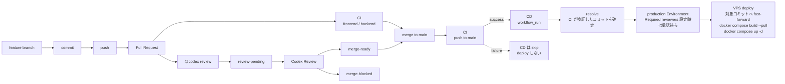

# CI/CD

## 1. 概要

GoTalk は GitHub Actions で CI、CD、Codex Review ラベル運用を行います。

現在存在する workflow は次の 4 つです。

- `.github/workflows/ci.yml`
- `.github/workflows/cd.yml`
- `.github/workflows/cd-staging.yml`
- `.github/workflows/codex-review-request.yml`

ステージング（同じ VPS の `staging.gotalk.chiemaru.com`）への deploy は、`cd-staging.yml` を手動で起動して行います（4 章を参照）。

Pull Request では CI とレビューを行います。`main` へ merge されると `push` to `main` で CI が起動し、その CI が完了すると `workflow_run` で CD workflow が起動します。CD は、`main` への push で起動した CI が成功した場合だけ deploy に進み、その CI が検証したコミットを VPS に反映します。CI が失敗した場合、CD の job は skip され、deploy も承認待ちも発生しません。CD の deploy job は GitHub Environment `production` を指定しているため、GitHub 側で Required reviewers が設定されている場合は、承認されるまで VPS への SSH 接続と Docker Compose による更新は実行されません。



## 2. CI

CI は `.github/workflows/ci.yml` で定義されています。

Trigger:

- `push` to `main`
- `pull_request`
- `workflow_call`（`cd-staging.yml` から呼び出す。入力は `ref`（文字列、省略可））

workflow 全体の `permissions` は `contents: read` です。各 job の `actions/checkout` には `ref: ${{ inputs.ref || '' }}` と `persist-credentials: false` を指定しています。`push` と `pull_request` では `inputs.ref` が空なので、今までどおり既定のコミットを checkout します。`workflow_call` では、`cd-staging.yml` が渡したコミットを checkout します。確かめる内容（lint、test、coverage、build、gofmt、vet）は、どの起動でも同じです。

### Frontend

Frontend job は `frontend` directory で実行されます。

| 項目 | 内容 |
| --- | --- |
| runner | `ubuntu-latest` |
| action | `actions/checkout@v7`、`actions/setup-node@v7` |
| Node.js | `22` |
| cache | `npm`、`frontend/package-lock.json` |
| install | `npm ci` |
| lint | `npm run lint` |
| test | `npm run test` |
| coverage | `npm run test:coverage` |
| build | `npm run build` |

### Backend

Backend job は `backend` directory で実行されます。

| 項目 | 内容 |
| --- | --- |
| runner | `ubuntu-latest` |
| action | `actions/checkout@v7`、`actions/setup-go@v7` |
| Go | `setup-go` の `go-version: "1.24"` と `check-latest: true`（1.24 系の最新パッチ） |
| cache | `backend/go.sum` |
| gofmt | `gofmt -l .` の結果が空でなければ失敗 |
| vet | `go vet ./...` |
| test | `go test ./...` |
| build | `go build -o /tmp/gotalk-backend .` |

Go のバージョンは次のように決まります。

| 対象 | 指定 | 使われる Go |
| --- | --- | --- |
| CI | `setup-go` の `go-version: "1.24"` と `check-latest: true` | CI の実行時点での 1.24 系の最新パッチ |
| 本番の Docker build（CD） | `backend/Dockerfile` の `golang:1.24-alpine` | CD の deploy script が `docker compose build --pull` で pull した、deploy の時点で `golang:1.24-alpine` が指しているパッチ |
| `backend/go.mod` | `go 1.24.0` | 必要な最低バージョン。CI と Docker のどちらのパッチもこれを満たす |

CI は実行のたびに 1.24 系の最新パッチをセットアップします。CD の deploy script は `docker compose build --pull` を実行し、base image の新しい版を pull してから build します。Docker の build は `--pull` を指定しない場合はローカルにある base image を使うため、`--pull` を付けることで、VPS に以前 pull した image が残っていても、deploy の時点で `golang:1.24-alpine` が指しているパッチが使われます。`backend/Dockerfile` の `alpine:3.22` と `frontend/Dockerfile` の `node:22-alpine` も同じく pull されます。

CI と本番の deploy の時点が異なる場合や、`golang:1.24-alpine` の更新が Go の新しいパッチのリリースより遅れる場合は、CI と本番でパッチバージョンが異なることがあります。差は、次の deploy で `golang:1.24-alpine` が新しいパッチを指していれば解消されます。

開発用の `docker compose build` や `docker compose up --build` は `--pull` を付けないため、手元にある base image を使います。

`ci.yml` の各 action（`actions/checkout@v7`、`actions/setup-node@v7`、`actions/setup-go@v7`）は、Node.js 24 で動くメジャーバージョンです。

`go vet` の前に gofmt の確認 step を実行します。`gofmt -l .` が整形されていないファイルを 1 件でも表示した場合は、そのファイル名を出力して job を失敗させます。

## 3. CD

CD は `.github/workflows/cd.yml` で定義されています。

| 項目 | 内容 |
| --- | --- |
| Trigger | `workflow_run`（`CI` の `completed`、branch `main`）、`workflow_dispatch`（手動） |
| job | `resolve`、`deploy`（`needs: resolve`） |
| concurrency | `deploy` job に group `gotalk-vps-deploy`、`queue: max`、`cancel-in-progress: false`（ステージングの `cd-staging.yml` と共通） |
| runner | `ubuntu-latest` |
| environment | `production` |
| deploy target | VPS |
| deploy method | SSH 経由で VPS 上の repository を CI が検証したコミットへ fast-forward し、base image を pull して build し、Docker Compose を起動 |

### 起動条件と deploy するコミット

CD は `workflow_run` で、`CI` workflow の完了（`completed`）を契機に起動します。`branches: [main]` のフィルタは、起動元の CI の run の `head_branch` で判定されます。そのため、`main` への push の CI のほか、fork の `main` branch から出された Pull Request の CI の完了でも CD は起動します。また、`workflow_run` は CI の結果にかかわらず完了時に起動します。push to main の CI が成功した場合以外は、`resolve` job の `if` で除外します。`resolve` job は、次の 3 つをすべて満たす場合だけ処理を進めます。

- `github.event.workflow_run.conclusion` が `success`
- `github.event.workflow_run.event` が `push`（fork の `main` から出された Pull Request の CI を含め、Pull Request の CI はここで除外する）
- `github.event.workflow_run.head_branch` が `main`

条件を満たさない場合は `resolve` job が skip され、`needs: resolve` の `deploy` job も skip されます。この場合、`production` Environment の承認待ちにもなりません。

`resolve` job は deploy するコミットを確定し、次を確認します。いずれかを満たさない場合は job を失敗させ、deploy には進みません。

| 確認内容 | 方法 |
| --- | --- |
| deploy するコミット | `workflow_run` では CI が検証したコミット（`github.event.workflow_run.head_sha`）。`workflow_dispatch` では入力の `sha`、省略時は実行時点の `main` の先頭 |
| 40 桁の SHA であること | 正規表現で確認 |
| `main` に含まれるコミットであること | GitHub API の compare（`<sha>...main`）が `identical` または `ahead` |
| `push` to `main` の CI が成功していること | GitHub API（List workflow runs for a workflow）で `ci.yml` の run を `head_sha`、`event=push`、`branch=main`、`status=success` で検索し、1 件以上あること |

`deploy` job は `environment: production` を指定しています。GitHub Environment 側で Required reviewers が設定されている場合、承認されるまで VPS への deploy は実行されません。承認待ちの間に `main` が進んでも、deploy するのは `resolve` job で確定したコミットです。

### deploy が重ならないようにする仕組み

`deploy` job に `concurrency`（group `gotalk-vps-deploy`、`queue: max`、`cancel-in-progress: false`）を指定しています。ステージングの `cd-staging.yml` の `deploy` job も同じ group を使うため、本番とステージングの deploy は、どの組み合わせでも同時には実行されません。同じ group で実行中の job がある間、新しい job は待機（pending）になり、実行中の deploy は途中で止めません。`queue: max` を指定しているので、待機中の job は新しい job に置き換えられず（キャンセルされず）、最大 100 件まで待機できます。待機中の job は先に来た順に処理されますが、実際の開始の時刻の揺れで順番は保証されないため、VPS の側の確認も残しています（下の段落）。

concurrency を workflow レベルではなく `deploy` job に置いているのは、`resolve` job を通った run だけを group に入れるためです。workflow レベルに置くと、`resolve` job が skip される run（main の CI が失敗した場合や、fork の `main` から出された Pull Request の CI が完了した場合など）も group に入り、正当な deploy と同じ待機の列に並びます。`deploy` job に置けば、`resolve` job が skip または失敗した run の `deploy` job は始まらないため、group に入りません。

GitHub のドキュメントでは、Environment を参照する job は、すべての deployment protection rule（Required reviewers など）を通ってから runner に送られるとされています。ただし、job レベルの concurrency と承認待ちのどちらが先に効くか（承認待ちの job が group を占有するかどうか）は、ドキュメントからは確定できません。以下は、承認待ちの job が実行中として group を占有する場合の運用です。

| 状況 | 動き | 運用 |
| --- | --- | --- |
| 本番かステージングの `deploy` job が承認待ちのまま、別の `deploy` job（本番でもステージングでも）が来た | 新しい job は pending になり、承認待ちの job が承認または Reject されるまで待つ（GitHub のドキュメント「Actions limits」では、Environment の承認待ちの上限は 30 日、run 全体の上限は待ち時間を含めて 35 日で、上限に達した run はキャンセルされる。承認されないまま残った job は、それまで group を占有しうる） | **承認するか Reject するかをすぐに決める**。特に、ステージングの承認を放置すると、本番の deploy がその後ろで待つ。本番で、古いコミットの job を承認すると古いコミットが deploy され、その後に pending の新しい job が動き出してもう一度承認を求める。最新のコミットだけを deploy したい場合は、古い job を Reject してよい（Reject した run は失敗として終わる） |
| pending の job がある状態で、さらに新しい `deploy` job が来た | pending の job は置き換えられず、新しい job はその後ろに並ぶ（最大 100 件） | 対応は不要。並んだ job は順に処理される（承認が必要な job は、順番が来たときに承認を求める） |

concurrency と承認待ちのどちらが先に効くかは、GitHub のドキュメントでは確定できません。上の表は承認待ちの job が group を占有する場合の動きです。承認が先に効く場合は、複数の `deploy` job が同時に承認待ちになり、承認した後に group の待機の列に並びます。どちらの場合も、次に書く VPS 側の確認により、本番を古いコミットへ戻すことはありません。

GitHub のドキュメントでは、concurrency group の中での実行順は保証されないとされています。そのため、deploy script でも、VPS の現在のコミット（`HEAD`）が deploy するコミットの祖先であることを確認します。新しいコミットがすでに反映されている状態で古いコミットの deploy が来た場合は、`git merge-base --is-ancestor` の確認で失敗し、古いコミットへ戻しません。

GitHub の group を通らない手作業や、想定外の重なりへの最後の守りとして、本番とステージングの deploy script は、同じロックのファイル（`~/.gotalk-deploy.lock`）を `flock` で取ります。本番の script は、build と起動を `flock -w 600 ~/.gotalk-deploy.lock sh -c 'docker compose --parallel 1 build --pull && docker compose up -d'` で囲みます。ステージングの script は、script の最初でロックを取り、fetch から起動までをロックの中で行います（4 章の「VPS の deploy script」を参照）。10 分待ってもロックを取れなければ、deploy は失敗します。

`flock` は、同じロックのファイルを取る処理どうしだけを直列にします。そのため、**VPS の上で（本番の `~/gotalk` でもステージングの `~/gotalk-staging` でも）手で build と起動をするときも、同じロックのファイルを取る次の形で実行してください**。ロックを取らずに `docker compose build` や `docker compose up` を実行すると、deploy と重なりえます。

```bash
flock -w 600 ~/.gotalk-deploy.lock sh -c 'docker compose --parallel 1 build --pull && docker compose up -d'
```

`--parallel 1` を付けるのは、VPS のメモリが少ない（961Mi。スワップ 2G）ので、Frontend と Backend の build を同時に行わず、1つずつ行ってメモリの使用を抑えるためです。`flock` の最大 10 分の待ちと、build と起動の合計に余裕を持たせるため、`appleboy/ssh-action` の `command_timeout` は `30m`（既定は `10m`）にしています。

本番とステージングの deploy が重ならないようにする仕組みをまとめると、次のとおりです。

| 重なり | 防ぎ方 |
| --- | --- |
| 本番の deploy とステージングの deploy（あらゆる組み合わせ） | GitHub の共通の concurrency group `gotalk-vps-deploy`（`queue: max`）。待機中のものは置き換わらず、順番に処理される |
| 上をすり抜けた場合（VPS の上の手作業など） | VPS の `flock`（同じロックのファイル `~/.gotalk-deploy.lock`、最大 10 分の待ち）。VPS で手で build と起動をするときも、同じロックのファイルを取る（上の形で実行する） |
| 本番が古いコミットに戻る | VPS の `HEAD` が `TARGET_SHA` の祖先であることの確認 |
| ステージングが本番と衝突する古い Compose で起動する | `resolve` と VPS の両方で、Docker と Compose のファイルが現在の `main` と完全に同じことを確かめる。VPS では、ロックを取った後に fetch して確かめ直し、そのままロックの中で build と起動まで行うので、確かめてから build までの間にほかの deploy や手作業が入らない（4 章を参照） |

### 手動での再 deploy

次の 2 つの方法があります。どちらの場合も、`main` 上の、`push` to `main` の CI が成功したコミットだけが deploy されます。

| 方法 | 動き |
| --- | --- |
| CD の run を GitHub の Actions 画面で Re-run する | 元の run と同じ event（同じ `workflow_run.head_sha`）で再実行し、同じコミットを deploy し直す。GitHub のドキュメントでは、Re-run は最初の実行から 30 日以内に限られる |
| CD workflow を `workflow_dispatch` で実行する（Actions 画面の「Run workflow」、または `gh workflow run cd.yml -f sha=<SHA>`） | `sha` を指定した場合はそのコミット、省略した場合は実行時点の `main` の先頭を deploy する。`resolve` job の確認を通らないコミットは deploy しない |

CI の run を Re-run して成功した場合も、CI の完了で `workflow_run` が起動するため、CD がもう一度起動します。

`workflow_dispatch` は、Actions 画面の「Use workflow from」（`gh workflow run` の `--ref`）で選んだ branch の `cd.yml` で実行されます。write 権限を持つ人が別の branch で `cd.yml` を書き換えて実行すると、`resolve` job の確認を迂回できます。その場合に残る歯止めは、`production` Environment の Required reviewers だけです。そのため、次の運用と設定を推奨します。

- `workflow_dispatch` は `main` から実行する（`gh workflow run cd.yml` は既定で default branch の `main` を使う）
- `production` Environment の Deployment branches and tags を `main` だけに制限する。Deployment branches の規則は run の `GITHUB_REF` に対して判定されるため、`main` 以外の branch から実行した `workflow_dispatch` の `deploy` job は Environment に拒否される。`workflow_run` の run の `GITHUB_REF` は default branch の `main` なので、この制限の影響を受けない

Environment の設定は GitHub のリポジトリ設定で管理しており、リポジトリのファイルからは現在の設定を確認できません。

### deploy が途中で失敗した場合

deploy script は `set -e` で実行するため、途中のコマンドが失敗するとそこで止まります。`git merge --ff-only` の後に `docker compose build --pull` や base image の pull が失敗した場合は、VPS の作業ツリーは対象のコミットに進みますが、コンテナは作り直されません。`docker compose up -d` まで進んでいないため、それまでのコンテナが古いコミットのまま動き続けます。`flock` が 10 分待ってもロックを取れなかった場合も、build の前に止まるので同じです。

この場合は、失敗した CD の run を Re-run すれば再実行できます。VPS の `HEAD` と `TARGET_SHA` が同じなので祖先の確認を通り、fast-forward は何もせずに、build から再実行されます。

VPS が同じコミットのままでも deploy script はそのまま実行できるため、再 deploy では base image の pull、build、service の更新がもう一度行われます。VPS ですでに新しいコミットが反映されている場合に、それより古いコミットを指定すると、上の祖先の確認で失敗します。古いコミットへの切り戻しは、この workflow ではできません。

VPS への SSH 接続には `appleboy/ssh-action` の v1.2.2 を使います。この job は VPS の SSH 秘密鍵を扱うため、action はタグではなくコミットの SHA（`2ead5e36573f08b82fbfce1504f1a4b05a647c6f`）で固定しています。固定されるのは action のコード（`action.yml` と `entrypoint.sh`）です。action が実行時に取得する drone-ssh のバイナリ（v1.8.1）は、実行のたびに GitHub Releases から取得され、checksum は検証されません。参照する GitHub Secrets は次のとおりです。

| Secret | 用途 |
| --- | --- |
| `VPS_HOST` | VPS host |
| `VPS_USER` | SSH user |
| `VPS_SSH_KEY` | SSH private key |

本番の secrets はリポジトリ全体の secrets にあります（`production` Environment には secrets を置いていません）。ステージングの `cd-staging.yml` も同じ名前を使いますが、`staging` Environment の secrets が優先されます（4 章の「secrets」を参照）。

VPS 上で実行する deploy script です。`TARGET_SHA` には `resolve` job で確定したコミットが入ります。`TARGET_SHA` は script に `${{ }}` で直接展開せず、step の `env` に設定したうえで、`appleboy/ssh-action` の `envs: TARGET_SHA` で VPS の shell に環境変数として渡します。deploy script でも、使う前に 40 桁の SHA であることを確認します。

```bash
# TARGET_SHA は appleboy/ssh-action の envs で環境変数として渡される
set -e
cd ~/gotalk
if ! printf '%s' "$TARGET_SHA" | grep -Eq '^[0-9a-f]{40}$'; then
  echo "Invalid TARGET_SHA: $TARGET_SHA"
  exit 1
fi
git fetch origin main
if ! git merge-base --is-ancestor HEAD "$TARGET_SHA"; then
  echo "Current HEAD $(git rev-parse HEAD) is not an ancestor of $TARGET_SHA; refusing to deploy"
  exit 1
fi
git merge --ff-only "$TARGET_SHA"
if [ "$(git rev-parse HEAD)" != "$TARGET_SHA" ]; then
  echo "HEAD $(git rev-parse HEAD) does not match $TARGET_SHA"
  exit 1
fi
flock -w 600 ~/.gotalk-deploy.lock sh -c 'docker compose --parallel 1 build --pull && docker compose up -d'
docker compose ps
```

deploy script は次の順に処理します。

1. `git fetch origin main` で `origin/main` を取得する
2. VPS の現在のコミット（`HEAD`）が `TARGET_SHA` の祖先であることを確認する（同じコミットの場合も含む）
3. `git merge --ff-only "$TARGET_SHA"` で、checkout 中の branch を `TARGET_SHA` まで fast-forward する。`origin/main` が `TARGET_SHA` より先に進んでいても、`TARGET_SHA` より先のコミットは反映しない
4. `HEAD` が `TARGET_SHA` と一致することを確認する（その前に、`TARGET_SHA` が 40 桁の SHA であることも確認する）
5. `flock -w 600 ~/.gotalk-deploy.lock` でロックを取り（10 分待っても取れなければ失敗）、ロックを持ったまま、`docker compose --parallel 1 build --pull` で base image を pull してから image を build し（メモリの使用を抑えるため、service を1つずつ build する）、`docker compose up -d` で service を更新する
6. `docker compose ps` で service 状態を表示する

VPS の作業ツリーは、`~/gotalk` の `main` を fast-forward で更新します。`TARGET_SHA` まで fast-forward した後の `main` は、`origin/main` の祖先です。

VPS では、手作業で `git pull` をしないでください。`git pull` は `origin/main` の先頭まで進めるため、CI がまだ成功していない（または失敗した）コミットまで作業ツリーが進み、動いているコンテナとの状態がずれます。その後に間のコミットの CD が来ると、祖先の確認で失敗します。その状態で `docker compose up` を実行すると、CI を通っていないコードが本番で動きます。

VPS の本番の clone（`~/gotalk`）では、手でファイルを変更しないでください。追跡しているファイルに手で変えたところがあると、そのファイルを変えるコミットを deploy するときに `git merge --ff-only` が止まり、deploy が失敗します（2026-10-22 に、手で書き換えた `frontend/vite.config.ts` が残っていて、実際に止まりました）。

再 deploy は `workflow_dispatch` か Re-run を使います。手作業でコミットを合わせる必要がある場合は、CI が成功したコミットを指定して `git merge --ff-only <SHA>` を実行します。

`docker compose --parallel 1 build --pull` と `docker compose up -d` はサービス名を指定していませんが、`backend-dev` には `profiles: ["dev"]` が付いているため対象にならず、`frontend` と `backend` だけを pull・build・起動します。

base image の pull は、`docker-compose.yml` の `build.pull` ではなく deploy script の `--pull` で行います。`docker-compose.yml` に `pull: true` を書くと、開発環境の `docker compose build` や `docker compose up --build` でも毎回 pull が行われるためです。

## 4. ステージング

### 構成

ステージングは、本番と同じ VPS で、本番と並べて動かします。Frontend の音声に関わる変更を、マージの前に iPhone で確かめるための環境です。

| 項目 | 内容 |
| --- | --- |
| VPS | 本番と同じ |
| ホスト名 | `staging.gotalk.chiemaru.com` |
| clone | `~/gotalk-staging`（本番の `~/gotalk` とは別の clone） |
| ポート | `frontend` は `127.0.0.1:5174`、`backend` は `127.0.0.1:8081`（本番の `5173`、`8080` と重ならない） |
| Compose | `~/gotalk-staging/.env` の `COMPOSE_PROJECT_NAME`、`COMPOSE_FILE`、`CONTAINER_PREFIX`、`FRONTEND_PORT`、`BACKEND_PORT` で、本番とプロジェクト、コンテナの名前、ポートを分け、`docker-compose.staging.yml`（`mem_limit`）を重ねる（[docker.md の「3.2 ステージングの override」](docker.md#32-ステージングの-overridedocker-composestagingyml) を参照） |
| nginx | HTTPS を終端し、Basic 認証をかけて、`127.0.0.1:5174` と `127.0.0.1:8081` に転送する。nginx の設定はリポジトリの外（VPS の `/etc/nginx`）にある |
| OpenAI API キー | ステージング専用のキー（`~/gotalk-staging/.env`） |
| SSH の鍵 | ステージング専用の鍵（`staging` Environment の secrets） |
| workflow | `.github/workflows/cd-staging.yml` |
| GitHub Environment | `staging`（Required reviewers は `shin-arita`、deploy できるブランチは `main` だけ） |

### secrets

`cd-staging.yml` は、本番と同じ名前の secrets（`VPS_HOST`、`VPS_USER`、`VPS_SSH_KEY`）を使います。ステージングの値（ステージング専用の SSH の鍵など）は、`staging` Environment の secrets に置いています。Environment の secrets は、リポジトリ全体の同じ名前の secrets より優先されるので、`cd-staging.yml` の `deploy` job（`environment: staging`）ではステージングの値が使われます。本番の secrets はリポジトリ全体の secrets にあります（`production` Environment には secrets を置いていません）。

SSH の鍵を分けても、VPS の上のユーザーは本番と同じ `ubuntu` なので、OS の上の権限は同じです。鍵を分けるのは、ステージングの鍵だけを失効できるようにするなど、運用のためです。

### 起動の仕方

`cd-staging.yml` は `workflow_dispatch` だけで起動します。`workflow_dispatch` は workflow のファイルが default branch（`main`）にあるときだけ使えます。

- `main` から起動する（Actions 画面の「Use workflow from」で `main` を選ぶ）。`main` 以外から起動した run は `resolve` job で失敗する。`staging` Environment の deploy できるブランチも `main` だけにしている
- 入力の `sha` に、deploy するコミットの 40 桁の SHA を指定する（必須）
- GitHub の画面の「Run workflow」のほか、`gh api` でも起動できる

```bash
gh api -X POST repos/shin-arita/gotalk/actions/workflows/cd-staging.yml/dispatches \
  -f ref=main -f 'inputs[sha]=<SHA>'
```

- `deploy` job は `staging` Environment の承認を待つ。承認は Shin が行う。**承認するか Reject するかはすぐに決める**。`deploy` job は本番と同じ concurrency group を使うので、承認待ちの job が group を占有する場合は、ステージングの承認を放置すると本番の deploy がその後ろで待つ（3 章の「deploy が重ならないようにする仕組み」を参照）

### 確かめる内容

| job | 確かめる内容 |
| --- | --- |
| `resolve`（`permissions` は `contents: read`、`pull-requests: read`） | `main` から起動されたこと（`github.ref` が `refs/heads/main`）。`sha` が 40 桁の小文字の 16 進数であること。`sha` が `main` に含まれるコミット（GitHub API の compare（`<sha>...main`）が `identical` または `ahead`。ステージングを `main` に戻すとき）か、このリポジトリから出された open の PR の HEAD（`head.repo.full_name` がこのリポジトリで、`head.sha` が `sha`）であること。Docker と Compose のファイルが現在の `main` と完全に同じであること（下の「Docker と Compose のファイル」） |
| `ci`（`needs: resolve`） | `ci.yml` を `workflow_call` で呼び出し、`ref` に `sha` を渡して、そのコミットで Frontend と Backend の CI を実行する。呼び出す `ci.yml` は caller（`main`）と同じコミットのもので、feature ブランチの `ci.yml` ではない。`secrets: inherit` は使わない |
| `deploy`（`needs: [resolve, ci]`、`permissions: {}`） | `staging` Environment の承認の後に、SSH で VPS に入り、下の deploy script を実行する。concurrency は本番と同じ group（`gotalk-vps-deploy`、`queue: max`、`cancel-in-progress: false`）。`appleboy/ssh-action` の `command_timeout` は `30m`。GitHub の API を使わないので、`GITHUB_TOKEN` に権限を与えない |

### Docker と Compose のファイル

ステージングは本番と同じ VPS で動くので、本番と衝突する古い（または変えた）Compose の設定で起動しないように、次のファイルが現在の `main` と完全に同じコミットだけを deploy します。

```text
:(glob)docker-compose*.yml
:(glob)compose*.yml
:(glob)**/Dockerfile*
:(glob)**/.dockerignore
```

git の pathspec に `:(glob)` を付けて、`**` を「任意の階層」の意味で使います。`docker-compose*.yml` と `compose*.yml` はリポジトリの直下のファイル、`Dockerfile*` と `.dockerignore` はどの階層のファイルも対象です。

`resolve` job で `git diff --quiet origin/main "$TARGET_SHA" -- <上の pathspec>` を実行し、差があれば失敗させます。承認と待ちの間に `main` が進むことがあるので、VPS の deploy script でも、ロックを取った後の build の直前に同じ確認をもう一度行います。

そのため、次のコミットはステージングに出せません。

- Docker と Compose のファイルを変える PR。今までどおり「マージ → 本番で確かめる」とする（そうした PR は音声の確認を目的にしないので、困らない見込み）
- `main` より古い Docker と Compose のファイルを持つブランチ。`main` を取り込んで（rebase か merge）から出す

### VPS の deploy script

VPS の上で実行する deploy script です。`COMPOSE_PROJECT_NAME` と `COMPOSE_FILE` は `~/gotalk-staging/.env` から読まれるので、script では指定しません。

```bash
# TARGET_SHA は appleboy/ssh-action の envs で環境変数として渡される
set -e
cd ~/gotalk-staging
if ! printf '%s' "$TARGET_SHA" | grep -Eq '^[0-9a-f]{40}$'; then
  echo "Invalid TARGET_SHA: $TARGET_SHA"
  exit 1
fi
# 同じ VPS の本番の deploy や手作業と重ならないよう、ここでロックを取り、build と起動までをロックの中で行う
# （確かめてから build までの間に main が変わらないようにするため。10 分待っても取れなければ失敗。ロックは script の終わりに外れる）
exec 9>~/.gotalk-deploy.lock
if ! flock -w 600 9; then
  echo "Could not acquire ~/.gotalk-deploy.lock within 600 seconds"
  exit 1
fi
git fetch origin main "$TARGET_SHA"
# 承認と待ちの間に main の Docker と Compose のファイルが変わっていないかを、build の直前にもう一度確かめる
if ! git diff --quiet origin/main "$TARGET_SHA" -- \
  ':(glob)docker-compose*.yml' ':(glob)compose*.yml' \
  ':(glob)**/Dockerfile*' ':(glob)**/.dockerignore'; then
  echo "Docker/Compose files of $TARGET_SHA differ from origin/main; refusing to deploy"
  exit 1
fi
git checkout --detach --force "$TARGET_SHA"
# 作業ツリーを TARGET_SHA の内容そのものにする（ignore 済みの .env は残す。-x は付けない）
git reset --hard "$TARGET_SHA"
git clean -fd
test "$(git rev-parse HEAD)" = "$TARGET_SHA"
test -z "$(git status --porcelain)"
docker compose --parallel 1 build --pull
docker compose up -d
docker compose ps
```

script は、SHA の形を確かめた後に、最初に `~/.gotalk-deploy.lock` のロックを取ります（`exec 9>~/.gotalk-deploy.lock` と `flock -w 600 9`。10 分待っても取れなければ失敗）。ロックの中で fetch、Docker と Compose のファイルの確かめ、checkout、build、起動を行うので、確かめてから build までの間に、ほかの deploy や手作業が入りません（`main` の Docker と Compose のファイルが、確かめた後に変わることがない）。ロックは script の終わり（SSH のシェルが終わるとき）に外れます。本番の script は build と起動のところだけでロックを取りますが、本番の確かめ（VPS の `HEAD` が `TARGET_SHA` の祖先であることと fast-forward）は、ロックを待つ間に `main` が進んでも結果が変わらないためです。

本番と違い、ステージングは fast-forward ではなく、`TARGET_SHA` を detached HEAD で checkout します（PR の HEAD も deploy するため）。Frontend は `./frontend` をコンテナに bind mount しているので、ステージングの clone のファイルは、実行中のコンテナや手作業で変わりえます。そのため、build の前に `git reset --hard` と `git clean -fd` で作業ツリーを `TARGET_SHA` の内容に強制的に戻し、`HEAD` が `TARGET_SHA` と一致すること、作業ツリーに差がないことを確かめます。ignore しているファイル（`.env`）は `git clean` で消しません（`-x` を付けない）。

**ステージングの clone（`~/gotalk-staging`）では、手でファイルを変更しないでください**。deploy のたびに `git reset --hard` と `git clean -fd` で消えます。

ロックのファイルは本番と同じです（3 章の「deploy が重ならないようにする仕組み」を参照）。build も本番と同じく `--parallel 1` で1つずつ行います。

### 初回の確認

ステージングを作った直後に、一度だけ次を確かめます。

- iPhone の Safari と Chrome で、Basic 認証の後に画面が開き、`/api` の呼び出しが通ること
- HMR の WebSocket が nginx を通って接続していること（`127.0.0.1:5174` への直接の接続に落ちていないこと）
- マイクの許可を初めて求められる状態と、許可した後の状態の両方で録音できること（ホスト名が違うので、マイクの許可は本番と別になる）

## 5. GitHub Actions

現在存在する workflow は次のとおりです。

| ファイル名 | Trigger | 役割 |
| --- | --- | --- |
| `.github/workflows/ci.yml` | `push` to `main`、`pull_request`、`workflow_call` | Frontend の lint / test / coverage / build、Backend の gofmt / vet / test / build。`workflow_call` では `cd-staging.yml` から呼ばれ、渡されたコミットを確かめる |
| `.github/workflows/cd.yml` | `workflow_run`（`CI` の完了、`main`）、`workflow_dispatch` | `push` to `main` の CI が成功したコミットを VPS に deploy（base image を pull して build）。`production` Environment を指定しており、Required reviewers が設定されている場合は承認後に実行 |
| `.github/workflows/cd-staging.yml` | `workflow_dispatch`（`main` から、入力は `sha`） | `main` に含まれるコミットか、このリポジトリから出された open の PR の HEAD を、CI を通した後にステージングに deploy。Docker と Compose のファイルが `main` と同じコミットだけ。`staging` Environment の承認の後に実行 |
| `.github/workflows/codex-review-request.yml` | `issue_comment` created、`pull_request` synchronize | `@codex review` request と Codex bot result に応じて PR label を更新 |

`codex-review-request.yml` は次の label を扱います。

| Label | 用途 |
| --- | --- |
| `review-pending` | Codex review 待ち |
| `merge-ready` | review 結果が merge 可能 |
| `merge-blocked` | review 結果が merge block |

`@codex review` を含む人間の PR comment では `review-pending` を追加し、`merge-ready` と `merge-blocked` を外します。Bot comment では本文の keyword から ready / blocked を判定し、`merge-ready` または `merge-blocked` を適用します。PR synchronize では `merge-ready` を外して `review-pending` を追加します。`merge-blocked` は synchronize では外しません。

## 6. 開発フロー

現在の運用フローは次のとおりです。

1. feature branch を作成する
2. Claude Code で実装、修正、テスト、ドキュメント更新を行う
3. commit する
4. branch を push する
5. Pull Request を作成する
6. GitHub Actions CI で Frontend / Backend の検証を行う
7. PR comment で `@codex review` を依頼する
8. Codex Review の結果に応じて `merge-ready` または `merge-blocked` label が付く
9. CI と review 結果を確認して merge する
10. `main` への push を trigger に CI が起動する
11. CI が成功すると CD が起動し、CI が検証したコミットを確定する（CI が失敗した場合は deploy しない）
12. `production` Environment に Required reviewers が設定されている場合は承認後に、そのコミットを VPS に deploy する

Frontend の音声に関わる PR は、完了の条件を次の順にします。

1. Codex のレビューで「指摘なし」になったコミットを、ステージングに deploy する（Shin の指示で Claude.ai が `gh api` で dispatch するか、Shin が GitHub の画面から実行する。承認は Shin。承認するか Reject するかはすぐに決める）
2. Shin が iPhone でステージングを確かめる
3. マージ → 本番に deploy → 本番でも短く確かめる

Docker と Compose に関わるファイルを変える PR と、`main` より古い Docker と Compose のファイルを持つブランチは、ステージングに出せません（4 章の「Docker と Compose のファイル」を参照）。

## 7. 品質保証

品質保証は CI、テスト、build、Codex Review を組み合わせます。

Frontend:

- ESLint: `npm run lint`
- Vitest: `npm run test`
- coverage: `npm run test:coverage`
- TypeScript / Vite build: `npm run build`

Backend:

- Go vet: `go vet ./...`
- Go test: `go test ./...`
- Go build: `go build -o /tmp/gotalk-backend .`

Codex Review:

- PR 差分に対する review request を `@codex review` comment で開始する
- review request 中は `review-pending` を使う
- review 結果 comment に応じて `merge-ready` または `merge-blocked` を付ける
- PR 更新時は `merge-ready` を外し、再 review 待ちとして `review-pending` を付ける

## 8. デプロイ後確認

CD workflow は deploy script の最後で `docker compose ps` を実行します。

デプロイ後は VPS 上の Docker Compose service 状態と、Backend の health check を確認します。Backend health check は `/health` で `{"status":"ok"}` を返します。

## 9. 関連ドキュメント

- [development.md](development.md)
- [testing.md](testing.md)
- [architecture.md](architecture.md)
