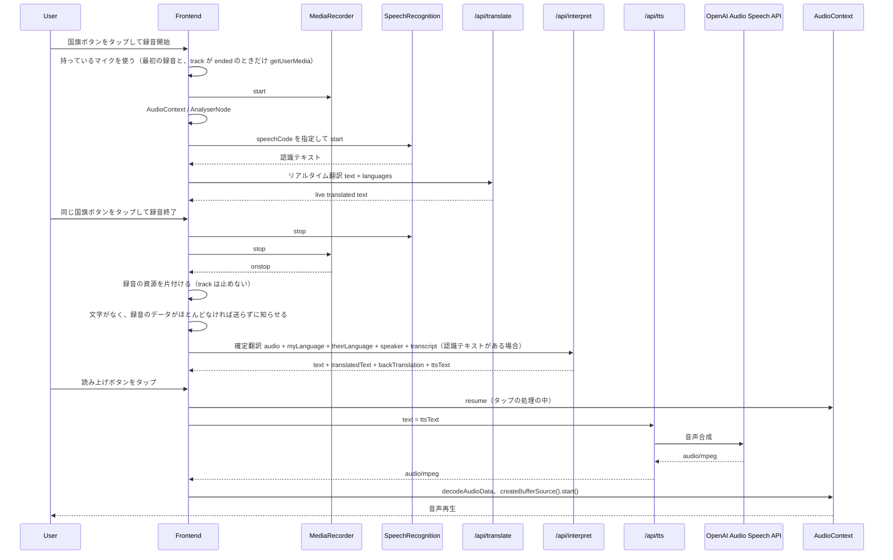
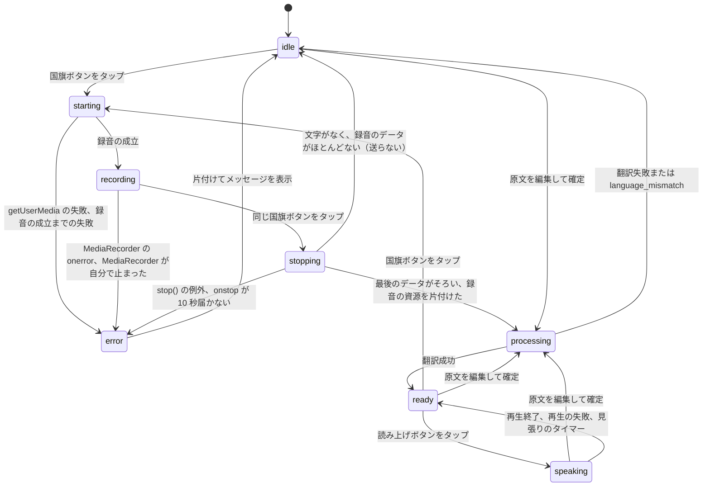

# Speech Flow

## 1. 概要

GoTalk の音声処理は、利用者が国旗ボタンから開始した発話を `MediaRecorder` で録音し、録音終了時に音声を Backend の `/api/interpret` へ送って確定翻訳を取得し、TTS で生成した音声をブラウザで再生するための処理です。

現在の構成は以下です。

- `getUserMedia` と `MediaRecorder` による録音（マイクはページ全体で1つ持ち、閉じずに使い回します）
- `SpeechRecognition` / `webkitSpeechRecognition` による録音中の認識テキスト表示
- 録音中のリアルタイム翻訳（`/api/translate`）
- 録音終了後の確定翻訳（`/api/interpret`）
- Backend の `/api/tts`
- OpenAI Audio Speech API
- Frontend の `AudioContext` での再生（`<audio>` は使いません）

`SpeechRecognition` は録音と並行して動き、認識テキストを表示とリアルタイム翻訳に使います。録音終了時は、認識テキストの有無にかかわらず録音音声を `/api/interpret` に送ります。認識テキストが得られている場合は `transcript` として同じリクエストに添え、Backend はそのテキストを翻訳します。認識テキストがない場合は、Backend が OpenAI の音声文字起こし API で言語判定と文字起こしを行います。

## 2. 全体フロー



## 3. Frontend の処理

Frontend の音声処理は、画面の `frontend/src/pages/InterpreterPage.tsx`、ページ全体で1つのマイクを持つ `frontend/src/audio/keptMic.ts`、録音の部品をまとめた hook の `frontend/src/hooks/useKeptAudioSession.ts` に分かれています。

| 担当 | 持つもの | 役割 |
| --- | --- | --- |
| `InterpreterPage` | 画面全体の状態（`InterpreterStatus`。[5. 音声入力状態](#5-音声入力状態)）、翻訳の問い合わせの番号、読み上げ用の `AudioContext` と今鳴らしている音 | 国旗のタップ、状態の遷移、Backend への問い合わせ、読み上げ、中断の片付けの呼び出し（`visibilitychange`、`pagehide`、`pageshow`、戻る、外れる）、マイクの音が来ないときの検出 |
| `keptMic` | ページ全体で1つのマイク（stream）と、`getUserMedia` を待っている Promise | `getUserMedia` と、`ended` の track があるときの取り直し。track の `ended` の見張り（[6.1](#61-マイクの持ち方と用語)） |
| `useKeptAudioSession` | 録音の資源（`MediaRecorder`、音声認識、`AudioContext` と node、`requestAnimationFrame` の番号）と、録音のセッションの番号。状態は持ちません。stream は `keptMic` が持つものを使い、閉じません | `MediaRecorder`、音声認識、音量の取得。「録音が成立した」「録音の最後のデータがそろった」「失敗した」を callback で画面に知らせます |

画面は、最初の描画のときに、URL の `exp` に `useAudioSession` の実験のスイッチ（[testing.md](testing.md) の「切り分けの実験のスイッチ」）が1つでもあれば、前の版の `frontend/src/hooks/useAudioSession.ts`（録音のたびに `getUserMedia` を呼び、録音の後に track を `stop()` する）を、なければ `useKeptAudioSession` を使います（`useInterpreterAudioSession`。画面が外れるまで変えません）。この文書は、スイッチがないとき（`useKeptAudioSession`）の動きを書きます。`useAudioSession` とスイッチは PR C で外します。

画面から hook を呼ぶのは、`start(言語)`、`stop()`（利用者の停止）、`abort(理由)`（中断）だけです。

国旗ボタンは、2 つの選択言語それぞれに表示されます。`handleFlagTap` は、`idle` または `ready` のときに表示中の原文、リアルタイム翻訳、翻訳文、`ttsText`、バックトランスレーション、エラーメッセージを空にし、状態を `starting` にしてから、タップされた国旗の言語で `start` を呼びます。`recording` 中に同じ国旗がタップされた場合は `stopRecording` を実行します。`recording` 中は反対側の国旗を、`starting`、`stopping`、`processing`、`speaking`、`error` の間は両方の国旗を操作できません。タップの判定には、React の状態ではなく `statusRef` の最新の値を使います。

`start` は、`keptMic` が持っているマイクが使えれば（track が1本以上あり、どれも `ended` でなければ）、`getUserMedia` を呼ばずに、`await` を挟まずにその stream で録音を始めます（利用者の操作の中で同期的に録音を始めます。実機で確かめた実験の `legacykeep` と同じです）。使えなければ `keptMic` で `navigator.mediaDevices.getUserMedia({ audio: true })` を呼んでマイク入力を取得します。stream に audio track が1本以上あり、すべての track の `readyState` が `live` であることを確かめてから、`getSupportedMimeType` で選んだ MIME type で `MediaRecorder` を作成して `start()` します。`MediaRecorder.isTypeSupported` で `audio/webm;codecs=opus`、`audio/webm`、`audio/mp4`、`audio/ogg;codecs=opus` の順に確認し、最初に対応しているものを使います。どれにも対応していない場合は MIME type を指定せずに `MediaRecorder` を作成します。ここまで成功したときが録音の成立（マイク ON）で、hook は `onRecordingStarted` で画面に知らせ、画面は状態を `recording` にします。

録音の成立の後に、補助の機能（音量の取得と音声認識）の開始を試みます。補助の機能が失敗しても、メッセージは出さずに録音を続け、診断のログにだけ残します。

- 音量の取得：`AudioContext.createMediaStreamSource(stream)` で入力元を作り、`AnalyserNode` に接続します。`requestAnimationFrame` のループで `getByteTimeDomainData` を読み、振幅を `onLevel` で画面に渡し、画面は国旗周辺の波紋要素の `transform` と `opacity` を更新します。`AudioContext` の作成に失敗した場合は、波紋の表示と診断の値が出ないだけです
- 音声認識：`SpeechRecognition` の constructor が取得できる場合は、タップされた国旗に対応する `lang.speechCode` を `recognition.lang` に設定して開始します。constructor が取得できない場合や、作成や `recognition.start()` が失敗した場合も、録音はそのまま継続し、Backend の文字起こしだけで結果を出します

音声入力中は、`recognizedText` の変更に対して 800ms のデバウンスで `/api/translate` を呼び出します。このリアルタイム翻訳は `text` と選択済み `languages` を送信します。レスポンスの `translatedText` があり、`sourceLanguage` が `unknown` でない場合に `liveTranslatedText` を更新します。

録音終了時の流れは [8. 録音終了後](#8-録音終了後) を、中断のときの片付けは [6. 録音のライフサイクル](#6-録音のライフサイクル) を参照してください。

音声再生は `handleSpeak` が担当します。`ready` のときだけ押せます。`/api/tts` に `{ text: ttsText }` を送信し、返却された `audio/mpeg` を `AudioContext` で鳴らします（`<audio>` は使いません。[9. TTS](#9-tts)）。

## 4. 録音と SpeechRecognition

録音は `MediaRecorder` が担当し、`SpeechRecognition` は録音と並行して認識テキストを取得します。

| 項目 | 実装上の扱い |
| --- | --- |
| `MediaRecorder` の MIME type | `audio/webm;codecs=opus`、`audio/webm`、`audio/mp4`、`audio/ogg;codecs=opus` の順に対応を確認し、最初に対応しているものを使います。 |
| `ondataavailable` | 自分のセッションが有効な場合だけ、サイズが 0 より大きい録音データを、そのセッションの資源のまとまりに追加します。無効なセッションのデータは捨てます。 |
| `onstop` | 届いたことを記録します（止める理由によらない）。自分のセッションが有効で、止める理由が `user` の場合だけ、録音データから `Blob` を作成し、録音の資源を片付け（track は `stop()` しません。`AudioContext` は `MediaRecorder` の `stop()` を呼ぶ前に閉じています）、`onRecordingStopped` で画面に渡します。利用者の停止の前に届いた場合（`MediaRecorder` が自分で止まった場合）は、録音の失敗として片付けます（[6.5](#65-録音の途中で止まったとき)）。中断のときはセッションを先に無効にしているので、何もしません。 |
| `MediaRecorder` の `onerror` | 自分のセッションが有効な場合だけ、録音の失敗として片付けます（理由 `error`）。録音のデータは送りません。 |
| `SpeechRecognition` constructor | `window.SpeechRecognition` があれば使用し、なければ `window.webkitSpeechRecognition` を使用します。どちらもなければ `SpeechRecognition` を使わずに録音だけを行います。 |
| `speechCode` | タップされた国旗の `Language.speechCode` を `recognition.lang` に設定します。 |
| `interimResults` | `true` に設定し、途中の認識結果も `onresult` で受け取ります。 |
| `continuous` | `true` に設定し、継続的に認識結果を受け取ります。 |
| `onresult` | 自分のセッションが有効な場合だけ、`event.results` 全体を走査し、各 result の `transcript` を連結して `onTranscript` で画面に渡します。画面は `recognizedTextRef.current` と `recognizedText` を更新し、`hasLiveTranscriptRef.current` を `true` にします。 |
| `onend` | 自分のセッションが有効で、画面の状態が `recording` で、止める指示が出ていない場合だけ、`recognition.start()` を再実行します。再開に失敗した場合は無視します。 |
| `onerror` | 自分のセッションが有効な場合だけ、エラーの種類を診断のログに残します。録音は続けます。 |
| `start` | `recognition.start()` を実行します。失敗した場合は無視し、録音は継続します。 |
| `stop` | 利用者の停止と中断の片付けで、止める指示を先に記録してから `stop()` を呼び、参照を捨てます。`stop()` の例外は捨てます。 |

`onend` で再開するのは、ブラウザ側で認識が終了しても、録音中の間は認識を継続するためです。`MediaRecorder` の state ではなく、セッションの番号、画面の状態、止める指示で判断するため、停止の途中や、中断した古いセッションで始め直すことはありません。

## 5. 音声入力状態

`InterpreterPage.tsx` の `status`（`InterpreterStatus`）は、録音から再生までの画面全体の状態を表します。状態を持つのは画面だけで、hook は持ちません。非同期の callback の中では、React の状態ではなく `statusRef` で最新の値を読みます。

| 状態 | 意味 | 国旗のタップ |
| --- | --- | --- |
| `idle` | 何もしていない（最初、またはエラーの後） | 録音を始める |
| `starting` | マイクを開いて録音を始めている途中（`getUserMedia` から録音の成立まで） | 受け付けない |
| `recording` | 録音の成立の後、話している。`SpeechRecognition` が認識テキストを更新し、リアルタイム翻訳が動きます | 同じ国旗なら止める。もう一方は受け付けない |
| `stopping` | 利用者が止めて、録音の最後のデータ（`MediaRecorder` の `onstop`）を待っている | 受け付けない |
| `processing` | 録音終了後に `/api/interpret` で確定翻訳を実行している状態、または原文編集後に `/api/translate` で再翻訳している状態。翻訳中メッセージを表示します | 受け付けない |
| `ready` | 翻訳文、バックトランスレーション、`ttsText` が取得済みの状態。読み上げを押せるのは、この状態のときだけです | 録音を始める |
| `speaking` | `/api/tts` の結果を `AudioContext` で再生している状態。再生終了、再生の失敗、見張りのタイマーで `ready` に戻ります。原文の編集はできます（編集すると読み上げを止めます） | 受け付けない |
| `error` | 失敗の後の片付けの途中（短い間）。片付けて `idle` に戻ります | 受け付けない |

主な状態遷移は以下です。



中断（画面が隠れる、ページを離れる、戻る、外れる）のときの遷移は、[6. 録音のライフサイクル](#6-録音のライフサイクル) の表に従います。中断のときに必ず `idle` に戻るわけではありません。

録音を止めた後は、録音の資源の片付けの後に `processing` へ進み、`/api/interpret` に送ります。ただし、認識テキストがなく、録音のデータが `MIN_INTERPRET_AUDIO_BYTES`（1024 バイト）より小さいときは送りません（[8.1](#81-マイクの音が来ないときの検出)）。原文の編集は、原文があり、`status` が `idle`、`ready`、`speaking` のときに開始でき、確定すると `/api/translate` で再翻訳して `processing` へ進みます。再翻訳が失敗した場合は、前の翻訳の結果が残っていれば `ready`（読み上げを押せる）に、残っていなければ `idle` に戻ります。

`status` を `recording` にするのは録音の成立の後です。`getUserMedia` や録音の成立までの処理に失敗した場合は、`recording` を経由せず、`error` を経て `idle` に戻り、メッセージを表示します（[10. エラー処理](#10-エラー処理)）。

「録音のセッションを片付けない限り `processing` に進まず、`ready` にならない限り読み上げを押せない」という状態の順番で、録音の途中に読み上げを鳴らさないことを保証します。マイク（stream）は開いたままが正常です。マイクを開いたまま `<audio>` で鳴らすと次の録音が壊れるため、読み上げは `AudioContext` で鳴らします。

## 6. 録音のライフサイクル

### 6.1 マイクの持ち方と用語

マイク（stream）は、`keptMic` がページ全体で1つだけ持ち、閉じません。

- 最初の録音のときに `getUserMedia` で開き、録音の後も、中断のとき（`hidden`、`pagehide`、戻る、外れる、失敗）も、track を `stop()` しません。`enabled` も変えません。ページを離れるとき（`pagehide`、`unload`）も閉じません（ページを離れるときはブラウザが閉じます）
- React の部品の外にあるので、言語の選択の画面に戻っても残り、もう一度選んで録音しても `getUserMedia` を呼びません
- 次の録音では、持っている stream に track が1本以上あり、どれも `ended` でなければ、そのまま使います。track がない、または `ended` の track があるときだけ、古い track をすべて `stop()` してから `getUserMedia` で取り直します。track の `stop()` を呼ぶのは、ここ（`keptMic.acquire()`）だけです
- `getUserMedia` を待っている間の2回目の要求には、同じ Promise を返します（2回呼びません）。使える stream を持っているときに `acquire()` が呼ばれた場合は、`getUserMedia` を呼ばずにその stream を返します（古い stream を開いたまま上書きしない守り。今の経路では、セッションは使える stream がないときだけ呼びます）。順番は「待っている Promise があれば返す → 使える stream があれば返す → 使えない stream の track を止める → `getUserMedia`」です
- track の `ended` の見張りは `keptMic` だけが持ちます。新しい stream を持ったときに、各 track に `ended` の listener を1回だけ付け、`ended` が来たら診断の記録（`endedEvents`。時刻と track の番号、最大 20 件）を残すだけにします（track は止めません。次の録音の開始で取り直します）。録音のセッションなど、ほかからは stream と track に listener を付けません
- `MediaRecorder`、音量の取得の `AudioContext`、音声認識は、録音ごとに作って片付けます

iPhone の Chrome などで、タップのたびに「マイクへのアクセスが許可されています」のお知らせが出ないよう、また録音のたびにマイクを開き直すと2回目からの録音が空になる不具合（実機の記録）を避けるため、この方式にしています（実験の `legacykeep` で、実機で 10 回とも成功した方式です）。

- **録音の資源の片付け**：`MediaRecorder` と音声認識が止まり、`MediaStreamAudioSourceNode` を `disconnect()` し、音量の取得用の `AudioContext` を `close()` し、`requestAnimationFrame` を取り消して、参照を捨てた状態です。track は止めません
- **録音の成立（マイク ON）**：今回の録音で使う stream に audio track が1本以上あり、使う track がすべて `readyState === "live"` で、`MediaRecorder` の作成と `start()` に成功した状態です
- **補助の機能**：音量の取得（`AudioContext` と analyser）と、音声認識（画面の途中の文字のため）です。録音の成立の後に開始を試み、失敗しても録音は続けます
- `track.enabled = false` は使いません

### 6.2 セッションの番号

`useKeptAudioSession` は、録音を始めるたびに新しいセッションの番号（1、2、3…）を振り、今有効なセッションの番号を1つだけ持ちます。録音のためのすべての資源（`MediaRecorder`、音声認識、`AudioContext` と node、`requestAnimationFrame` の番号、止める理由、止める指示）は、セッションの番号といっしょに1つのまとまりとして持ち、片付けはそのまとまりに対して行います。

次のときに、今有効なセッションを無効にします（今有効な番号を「なし」にします）。

- 中断の片付けのとき
- 失敗の片付けのとき
- 利用者の停止で、最後のデータがそろって画面に渡した後

非同期の処理から戻るたびに、自分のセッションの番号が今有効な番号と同じかを確かめ、同じでなければ結果を使いません。

| 戻ってくる処理 | 無効なセッションのとき |
| --- | --- |
| `getUserMedia`（`keptMic.acquire()`） | 取得した stream は閉じずに（`keptMic` が持ち、次の録音で使い回します）、何もしません |
| `MediaRecorder` の `ondataavailable`、`onstop`、`onerror` | データを捨て、Backend には送りません |
| 音声認識の `onresult`、`onend`、`onerror` | 何もしません。`onend` での始め直しは、自分のセッションが有効で、画面の状態が `recording` で、止める指示が出ていないときだけ行います |
| 音量の取得の `requestAnimationFrame` | 次を予約しません |

### 6.3 翻訳の問い合わせの番号

翻訳の問い合わせ（`/api/interpret` と、編集した文の `/api/translate`）には、録音のセッションの番号とは別に、問い合わせ専用の番号を振ります。問い合わせを始めるたびに番号を増やし、今有効な問い合わせの番号を1つだけ持ちます。`pagehide`、戻る、外れるで止めたときは、`AbortController` で `fetch` を止め、今有効な番号を「なし」にします。結果や失敗が戻ってきたら、自分の番号が今有効な番号と同じときだけ画面に反映します。話している途中の文字を先に訳す問い合わせ（リアルタイム翻訳）は、別の `AbortController` で扱い、この番号の対象にはしません。

読み上げ（`/api/tts` と `AudioContext` での再生）にも、同じ考え方の番号を振ります。読み上げを止めたときは、番号を「なし」にし、`/api/tts` の `fetch` を止め、見張りのタイマーを止め、今鳴らしている `AudioBufferSourceNode` の `onended` を外して `stop()` と `disconnect()` を呼びます。後から戻った音声は再生せず、後から来た `resume()` の結果も使いません。

### 6.4 利用者の停止と中断の片付けの違い

| | 利用者の停止（`stop()`） | 中断の片付け（`abort(理由)`） |
| --- | --- | --- |
| きっかけ | 録音中の国旗をもう一度タップ | `hidden`、`pagehide`、`back`、`unmount`、`error` |
| 止める理由 | `user` | 中断の理由 |
| セッション | 最後のデータがそろって画面に渡した後に無効にします | 最初に無効にします |
| 録音のデータ | Backend に送ります | 送りません（後から来る `onstop` は何もしません） |

利用者の停止の順番は次のとおりです。

1. 状態を `stopping` にし、止める理由を `user` にします
2. 止める指示を先に記録してから、音声認識を `stop()` し、音量の取得を止めます（`requestAnimationFrame` を取り消します）
3. 音量の取得の資源を片付けます（`MediaStreamAudioSourceNode` を `disconnect()` し、`AudioContext` を `close()` します。`close()` の完了は待ちません）。順番の理由は、下の「片付けの順番」を参照してください
4. `MediaRecorder` を `stop()` し、`onstop` を待ちます（最後の `ondataavailable` を受け取るため。timeslice なしの録音では、最後のデータが録音の全体です）。待ち始めたら、見張りのタイマー（`RECORDER_STOP_TIMEOUT_MS`、10 秒）を始めます
5. `onstop` で、自分のセッションが有効で、止める理由が `user` であることを確かめてから、見張りのタイマーを止め、録音のデータをまとめます
6. 残りの参照を捨てます（録音の資源の片付け。`AudioContext` は 3 で閉じています）。track は `stop()` しません
7. 状態を `processing` にし、Backend に送ります（マイクの音が来ないときは送りません。[8.1](#81-マイクの音が来ないときの検出)）
8. 翻訳の結果が出たら `ready` にします

利用者の停止の経路ごとの動きは、次のとおりです。

| 経路 | 動き |
| --- | --- |
| 通常（`MediaRecorder` が `recording`） | `stop()` を呼び、`onstop` を待って送ります |
| `MediaRecorder` がすでに `inactive` で、`onstop` がまだ届いていない（`MediaRecorder` が自分で止まり、`dataavailable` と `stop` のイベントがこれから届く） | `stop()` は呼ばず、止める指示を記録して `onstop` を待ちます。届いたら、通常と同じく、最後のデータを含めて送ります |
| `MediaRecorder` がすでに `inactive` で、`onstop` が届き済み | 録音が利用者の停止の前に止まっていたので、録音の失敗として片付けます（ふつうは、`onstop` が届いた時点で [6.5](#65-録音の途中で止まったとき) の扱いになっているので、ここには来ません） |
| `stop()` が例外を出した | 録音の失敗として片付けます。診断のログに `recorder_stop_failed:<name>` を残します |
| `onstop` が 10 秒以内に届かない | 録音の失敗として片付けます。診断のログに `recorder_stop_timeout` を残します |

「録音の失敗として片付ける」は、中断の片付け（理由 `error`）をして、Backend には送らず、「うまく録音できませんでした。もう一度お願いします」（`recording_failed`）を2つの言語で表示し、`idle` に戻すことです。見張りのタイマーは、`onstop` が届いたとき、中断の片付けのとき、セッションが無効になったときに必ず止めるので、古いセッションのタイマーが新しいセッションに作用することはありません。

見張りの時間の 10 秒は、実機で確かめていない仮の値です。`stop()` から `onstop` までは、ふつうは数十から数百ミリ秒ですが、古い端末で、上限に近い長い録音（`audio/mp4` など）を止めた場合は、1 秒を超えることがあり得ます。短すぎると、正常な長い録音を「録音の失敗」として捨ててしまいます。長すぎた場合の損失は、ブラウザの不具合で `onstop` が届かないときに、`stopping` のまま長く待つことだけなので、損失の小さい長めの値にしています。診断の情報には、利用者の停止で `stop()` を呼んでから（`MediaRecorder` がすでに `inactive` のときは、止める指示を記録してから）`onstop` が届くまでの時間（`stopLatencyMs`）と、見張りのタイマーで片付けたか（`stopTimedOut`）と、それまでに待った時間（`stopWaitedMs`）を残します。PR 2 の診断の表示でこの時間を測り、実測の値に余裕を足した値に見直します。

中断の片付け（失敗の片付けを含みます）では、理由（`hidden`、`pagehide`、`back`、`unmount`、`error`）によらず、今有効なセッションを先に無効にしてから、音声認識と音量の取得を止め、`MediaStreamAudioSourceNode` を `disconnect()` して `AudioContext` を閉じ、その後に `MediaRecorder` が止まっていなければ `stop()` し、参照を捨てます。録音の資源だけを片付け、track は `stop()` しません。

片付けの順番：利用者の停止でも中断の片付けでも、「音声認識の停止 → `requestAnimationFrame` の取り消し → `disconnect()` → 音量の取得の `AudioContext` の `close()` の開始 → `MediaRecorder` の `stop()`」の順にします（track は止めません）。前の版（`useAudioSession`）と同じ順番で、実験の `legacykeep` とも同じです。

### 6.5 録音の途中で止まったとき

録音の途中で track が終わる（`ended`。ほかのアプリがマイクを使った、OS が止めたなど）と、`MediaRecorder` は自分で止まり、`dataavailable` と `stop` のイベントを届けます。

- track の `ended` は `keptMic` が受け取り、診断の記録（`endedEvents`）を残すだけです（録音のセッションは track に listener を付けません）。次の録音の開始で、`ended` の track を止めてから `getUserMedia` で取り直します
- 利用者の停止の前に（止める指示が出ていないときに）`onstop` が届いたら、診断のログに `recorder_stopped_unexpectedly` を残し、録音の失敗として片付けます（Backend には送らず、`recording_failed` を表示して `idle` に戻します）
- 録音の途中の `MediaRecorder` の `onerror` も、録音の失敗として片付けます（診断のログは `recorder_error:<name>`）

### 6.6 中断のときの状態

中断の後の状態は、中断したときの状態と理由によって、次の表のとおりにします。`hidden`（`visibilitychange` で `hidden`）は一時的に GoTalk から離れる（戻ってくる）こと、`pagehide` はページそのものを離れること、`back`（言語の選択の画面に戻る）と `unmount`（コンポーネントが外れる）は画面が外れることとして扱います。

| 中断したときの状態 | `hidden` | `pagehide` | `back`、`unmount` | `error` |
| --- | --- | --- | --- | --- |
| `starting`、`recording`、`stopping` | 録音のセッションを中断して録音の資源を片付け、`idle` に戻します | 録音のセッションを中断して録音の資源を片付け、`idle` に戻します | 録音のセッションを中断して録音の資源を片付けます（画面は外れます） | 録音のセッションを中断して録音の資源を片付け、`idle` に戻します（メッセージを表示します） |
| `processing` | 何もしません。状態は `processing` のままで、Backend への問い合わせは続け、結果が来たら `ready` にします。その間は国旗を押せません | Backend への問い合わせを止め、結果を使いません。状態は `idle` に戻します | Backend への問い合わせを止めます（画面は外れます） | （起きません。Backend の失敗は今までの扱いのままです） |
| `ready` | 何もしません | 何もしません | 何もしません（画面は外れます） | （起きません） |
| `speaking` | 今鳴らしている音を止め（`stop()` と `disconnect()`）、`ready` に戻します（翻訳の結果は残します） | 今鳴らしている音を止め、`ready` に戻します | 今鳴らしている音を止めます（画面は外れます） | （起きません。読み上げの失敗は今までの扱いのままです） |
| `idle` | 何もしません | 何もしません | 何もしません | （起きません） |

どの理由のときも、マイクの track は `stop()` しません（[6.1](#61-マイクの持ち方と用語)）。`unmount`（画面が外れる）のときは、読み上げを止めた後に、読み上げ用の `AudioContext` を `close()` します（読み上げの出力用で、マイクではありません）。

`processing` の間は、録音のセッションはすでに無効で、録音の資源は片付いているので、`hidden` で片付けるものはありません。`processing` のまま待つことで、古い翻訳の結果が、後から始めた新しい録音の画面を上書きすることを防ぎます（新しい録音は、結果が来て `ready` になるまで始められません）。

`hidden` から `visible` に戻っても、自動では録音を始めません。次のタップで新しいセッションを始めます（持っているマイクが使えれば、そのまま使います）。`back` の後には `unmount` が続けて呼ばれますが、片付けは冪等なので問題ありません。

### 6.7 bfcache から戻ったとき

`pagehide` は、bfcache に入るとき（`event.persisted === true`）にも起き、その後に `pageshow` でページが戻ってくることがあります。`pagehide` の中で状態を変えても、戻ったときにその状態になっている保証はないため、`pagehide` のときに「戻ったときにするべき状態」を ref（`pagehideRecoveryStatusRef`）に記録し、`pageshow`（`event.persisted === true`）で明示的に直して、記録を消します。

| `pagehide` のときの状態 | bfcache から戻ったときの状態 |
| --- | --- |
| `starting`、`recording`、`stopping` | `idle` |
| `processing` | `idle` |
| `idle` | `idle` |
| `ready` | `ready` |
| `speaking` | `ready` |
| `error` | `idle` |

- `pageshow` では、録音のセッションの資源、翻訳の問い合わせ、読み上げ（`/api/tts` の問い合わせと、今鳴らしている音）が残っていないことも確かめ、残っていれば中断の片付けをして、`unexpected_active_session_after_pageshow` を診断のログと `console.warn` に残します
- `pageshow` では、自動でマイクを開いたり、問い合わせをやり直したりしません。メッセージも出しません（`processing` の間に離れた場合、話した内容の翻訳は失われますが、利用者がページを離れた結果なので、知らせません）
- `event.persisted === false` の `pageshow`（ふつうの読み込み）では何もしません

### 6.8 冪等な片付け

片付けは、何回呼んでも、どの順番で重なっても壊れないようにしています。

- 片付けの最初に、今のまとまりを手元の変数に移し、まとまりの参照を先に空にしてから、手元の変数に対して止める処理をします。片付けが重なって呼ばれても、2回目は空のまとまりを見て何もしません
- `MediaRecorder` が `inactive` なら `stop()` しません
- 録音の資源の片付けでは、track を `stop()` しません（track の `stop()` を呼ぶのは `keptMic` が取り直すときだけで、`ended` の track に `stop()` を呼んでも害はありません）
- `AudioContext` が `closed` なら `close()` しません。`close()` の拒否は捨てます
- 音量の取得の資源の片付け（`disconnect()` と `close()`）は1回だけ行い、始めた `close()` の完了の Promise をセッションの資源のまとまりに持ちます。2回目以降の片付けは、その Promise を返します。そのため、`abort(理由)` の Promise は、どの経路でも（利用者の停止で先に `close()` を始めた後の `stopping` の間の中断でも）`AudioContext` の `close()` の完了まで待ちます
- 止める指示の後に、新しい音声の部品を始めません
  - 止める指示の後や、音量の取得の資源の片付けの後は、音量の取得を始めません（`AudioContext` を作りません）。片付けは2回目以降、1回目の Promise を返すだけなので、その後に作った `AudioContext` は閉じられず、マイクの track につながったまま残るためです
  - 止める指示の後は、音声認識を始めません（constructor も呼びません）。始めても `onstop` の後の片付けで止まるので残りませんが、`MediaRecorder` の `stop()` の直後に音声認識を始めてすぐ止める並びが、iPhone の Chrome（WebKit）の音声のセッションに影響しないとは言い切れないためです（2回目からの録音が空になる不具合が、音声の部品の始まりと終わりの順番による、という仮説のため）
  - どちらも、今の経路では起きませんが、将来の変更への守りとして入れています（録音の成立の callback の中の中断は、その後にセッションが有効かを確かめて止めますが、利用者の停止はセッションを有効のまま残すので、その確かめでは止まりません。画面は利用者の停止を国旗のタップからだけ呼ぶので、callback の中で呼ばれることはありません）
- `requestAnimationFrame` の番号が空なら取り消しません
- 音声認識が空なら何もしません。`stop()` の例外は捨てます

`handleSpeak` の最初には、「有効な録音のセッションが残っていれば、中断の片付けが終わるのを待ってから鳴らす」守りがあります（マイクは開いたままが正常で、残っていてはいけないのは録音のセッションです）。これは正常な経路では起きない異常の検知で、`unexpected_active_audio_session_before_tts` を診断のログと `console.warn` に残します。これが出た場合は、片付けの不具合として直します。

### 6.9 診断の情報

`useKeptAudioSession` は、録音ごとに次をメモリの上に残します（最新の 10 回の録音と、200 件の出来事）。Backend には送らず、録音した音声と会話の本文は残しません。URL に `exp` があるとき（`?exp=` のように空でも）は、診断の表示の「コピー」の JSON に入ります（[testing.md](testing.md)）。

- セッションの番号、止める理由
- 状態の遷移とその時刻（`status:recording` などの出来事として残します）
- `getUserMedia` の開始と成功の時刻、エラーの `name`。この録音で `keptMic.acquire()` を呼んだか（`acquired`）、持っているマイクを使い回したか（`reused`。出来事は `microphone_reused`）
- track の `readyState`、`enabled`、`muted`
- `MediaRecorder` の state、mimeType、録音の時間、録音の大きさ、エラー、利用者の停止から `onstop` までの時間（`stopLatencyMs`）、見張りのタイマーで片付けたか（`stopTimedOut`）と待った時間（`stopWaitedMs`）
- `AudioContext` の state、音量の RMS と最大値と、取れたサンプルの数
- 音声認識の結果があったかと、その文字数（本文は残しません）
- 画面が残す出来事：マイクの音が来ないと判断した録音（`no_audio_detected:bytes=<大きさ>,ms=<長さ>`）、読み上げの見張りのタイマーで `ready` に戻したこと（`tts_ended_timeout`）、読み上げの `resume()` の失敗（拒否されたとき（同期の例外を含む）は `tts_resume_rejected:<例外の name>`、解決したが `running` でないときは `tts_resume_not_running:<state>`）、読み上げ用の `AudioContext` を作れなかったこと（`tts_context_create_failed:<例外の name>`）

`keptMic` は、`getUserMedia` を呼んだ回数（`getUserMediaCalls()`）と、track の `ended` の記録（`endedEvents()`）を持ちます。`useKeptAudioSession` の `getDiagnostics()` の結果に `keptMic: { getUserMediaCalls, endedEvents }` として入り、「コピー」の JSON にも入ります（診断の表示の画面には出しません。実験のスイッチのとき（`useAudioSession`）は入りません）。iPhone が track を止めたか（`ended` が来たか）を確かめ、`microphone_no_audio` が出たときの原因の切り分けに使います。

2回目から録音が空になる不具合の切り分けのため、URL の query の `exp` で指定する実験のスイッチと、その診断の表示を入れています（詳しくは [testing.md](testing.md) の「切り分けの実験のスイッチ」）。`useAudioSession` の実験のスイッチがあるときは、前の版の `useAudioSession` を使います。スイッチと `useAudioSession` は PR C で外します。

## 7. リアルタイム翻訳

リアルタイム翻訳は `recording` 中だけ動作します。

`recognizedText` は `SpeechRecognition.onresult` から更新される表示用の認識テキストです。`recognizedTextRef` は、録音終了時に最新の認識テキストを同期的に参照するために使われます。

`useEffect` は、`status !== 'recording'` または `recognizedText` が空の場合は何もしません。条件を満たす場合、800ms の `setTimeout` で `/api/translate` を呼び出します。cleanup では `clearTimeout` と `AbortController.abort()` を実行するため、`recognizedText` が短時間で更新されると前のリクエスト準備は取り消されます。送信中の `fetch` も、`recognizedText` が変わったときや録音を止めて `status` が変わったときに abort されます。`fetch` には 30 秒のタイムアウトもあり、タイムアウトになったら abort します。

送信する JSON は以下です。

```json
{
  "text": "recognizedText",
  "languages": [
    { "id": "first selected language id", "label": "first selected language label" },
    { "id": "second selected language id", "label": "second selected language label" }
  ]
}
```

レスポンスが成功し、`data.translatedText` が存在し、`data.sourceLanguage !== 'unknown'` の場合だけ `liveTranslatedText` を更新します。リアルタイム翻訳の結果は `recording` 中だけ表示されます。リアルタイム翻訳中の `AbortError`、ネットワークエラー、HTTP エラーは UI エラーとして表示せず無視します。

## 8. 録音終了後

`stopRecording` は録音終了時の入口です。`statusRef.current` が `recording` でない場合は何もしません。

処理内容は以下です（[6.4 利用者の停止と中断の片付けの違い](#64-利用者の停止と中断の片付けの違い)）。

- `status` を `stopping` にする
- 波紋要素の `transform` と `opacity` を初期化する
- hook の `stop()` を呼ぶ。hook は、止める指示を記録してから、音声認識と音量の取得を止め、`AudioContext` を閉じてから、`MediaRecorder` を停止する

`MediaRecorder` の `onstop` で、hook は録音データから `Blob` を作成し、録音の資源を片付け（track は止めません）、`onRecordingStopped` で画面に渡します。画面は、[8.1](#81-マイクの音が来ないときの検出) の判定の後、`recordingFlagIndex` を `null` にし、`callInterpretApi(blob)` で `status` を `processing` にして送信します。中断のときは、セッションを先に無効にしているので、`/api/interpret` は呼ばれません。

`callInterpretApi` は `/api/interpret` に次を `multipart/form-data` で送信します。

- `audio`：録音データ。ファイル名は `recording.webm`、`recording.mp4`、`recording.ogg` のいずれか
- `myLanguage`：タップされた国旗の言語の `{ id, label }`
- `theirLanguage`：もう一方の言語の `{ id, label }`
- `speaker`：タップされた国旗の言語 ID
- `transcript`：`SpeechRecognition` の認識テキスト。認識テキストが得られた場合だけ送信

タイムアウトは 65 秒で、タイムアウトになったら `AbortController` で `fetch` を abort します。`processing` 中の翻訳カードには、話者側と相手側の両言語の「翻訳中」と「お待ちください」のメッセージを 1.2 秒ごとに切り替えて表示します。

確定翻訳の成功時、Frontend はレスポンスから以下を state に保存します。

- `translatedText`
- `ttsText`
- `backTranslation`

録音中に `onresult` が一度も呼ばれなかった場合（`hasLiveTranscriptRef.current` が `false`）は、レスポンスの `text` を原文として表示します。`onresult` は呼ばれたが認識テキストが空だった場合は、`transcript` を送らず、`text` も原文として表示しません。`ttsText` はレスポンスに存在する場合はその値を使い、存在しない場合は `translatedText` を使います。成功後は `status` を `ready` にし、履歴に原文、翻訳文、バックトランスレーション、翻訳元言語、翻訳先言語を追加します。履歴に表示するのは原文と翻訳文です。

### 8.1 マイクの音が来ないときの検出

マイクを開いたままにする方式では、ブラウザを裏に回したときや、ページを読み込み直したときなどに、マイクから音が来なくなる（録音のデータがほとんど空になる）ことがあり、防げません。そのため、`handleRecordingStopped(blob)` で、`callInterpretApi` の前に次の判定をして、中身のない録音を Backend（OpenAI）に送らずに知らせます。録音の長さは、画面が `recording` になった時刻（`handleRecordingStarted` で `recordingStartedAtRef` に記録）から、`handleRecordingStopped` が呼ばれた時刻までです。

| 条件 | 扱い |
| --- | --- |
| 音声認識の文字がある（`hasLiveTranscriptRef.current` で、`recognizedTextRef.current` が空でない） | 今のまま送ります（Backend は文字を使い、音声は使いません） |
| 文字がなく、`blob.size` が `MIN_INTERPRET_AUDIO_BYTES`（1024 バイト）未満で、録音の長さが 1000 ミリ秒以上 | マイクの音が来ていないと判断します。送らず、「マイクの音を受け取れませんでした。ブラウザを一度終了してから、開き直してください」（`microphone_no_audio`）を2つの言語で表示し、`recordingFlagIndex` を `null`、状態を `idle` にします。診断のログに `no_audio_detected:bytes=<大きさ>,ms=<長さ>` を残します |
| 文字がなく、`blob.size` が 1024 バイト未満で、録音の長さが 1000 ミリ秒未満（押してすぐ止めた） | 送らず、「うまく録音できませんでした。もう一度お願いします」（`recording_failed`）を表示して `idle` にします |
| それ以外 | 今のまま送ります |

閾値の理由：実機の記録で、成功した録音は 74KB 以上（`legacykeep`）、壊れた録音は 5 バイトでした。1 秒以上の正常な録音は、webm でも mp4 でも数 KB 以上になります。1024 バイトは、その間で、正常な録音を誤って止めない余裕を取った値です。

この判定は、`useKeptAudioSession` と、実験のスイッチのときの `useAudioSession` の両方に効きます。

`/api/interpret` が `422` で `language_mismatch` を返した場合は、言語不明メッセージを表示し、翻訳文とバックトランスレーションを空にして `idle` に戻します。それ以外の失敗ではタイムアウトまたはエラー内容に応じたメッセージを表示し、`idle` に戻します。結果や失敗は、問い合わせの番号が今有効な番号と同じときだけ画面に反映します（[6.3 翻訳の問い合わせの番号](#63-翻訳の問い合わせの番号)）。

## 9. TTS

TTS は、確定翻訳（`/api/interpret`）または原文編集後の再翻訳（`/api/translate`）が成功した後に、翻訳カードの読み上げボタンから実行されます。

Frontend は `handleSpeak` で、`status` が `ready` であることを確かめてから `speaking` にし、Backend の `/api/tts` に以下を送信します。

```json
{
  "text": "ttsText"
}
```

Backend の `/api/tts` は `POST` のみ受け付けます。`OPENAI_API_KEY` が未設定の場合は `service unavailable`、request body が不正な場合は `invalid request body`、`text` が空白のみの場合は `text is required` を返します。

TTS model は `OPENAI_TTS_MODEL` を使い、未設定時は `gpt-4o-mini-tts` です。voice は `OPENAI_TTS_VOICE` を使い、未設定時は `marin` です。Backend は OpenAI Audio Speech API に `model`、`input`、`voice` を送信し、成功時は `audio/mpeg` を Frontend に返します。

`/api/tts` のタイムアウトは 30 秒で、タイムアウトになったら `AbortController` で `fetch` を abort します。

Frontend は、読み上げを `AudioContext` で鳴らします。マイクを開いたまま `<audio>` で鳴らすと、次の録音が壊れるためです。`<audio>`（`new Audio()`、オブジェクト URL）は使わず、失敗しても `<audio>` に切り替えて鳴らし直すことはしません。

1. 読み上げ用の `AudioContext` を、画面で1つ持ちます（`ttsContextRef`）。最初の読み上げのタップのときに作り、画面が外れるまで使い回します。作れないとき（`new AudioContext()` の例外。`AudioContext` がない、作れる数の上限など）は、読み上げの失敗として、ログ（`logApiError` と診断の出来事 `tts_context_create_failed:<例外の name>`）を残し、文言は出さず、`ready` のまま戻ります。鳴らせないので `/api/tts` は呼ばず、`speaking` にもしません。`ttsContextRef` は空のままにし、次の読み上げのタップでもう一度作るのを試します
2. タップの処理の中（`await` の前）で `resume()` を呼び、Promise を持っておきます（ここでは待ちません。iPhone では、利用者の操作の中でないと鳴らせないためです）。`resume()` が同期の例外を出したときは、拒否された Promise と同じに扱います
3. `/api/tts` の結果を `arrayBuffer()` で受け取り、`decodeAudioData` で `AudioBuffer` にします
4. 再生を始める直前に `resume()` の結果を確かめます。拒否されたとき、または解決しても `state` が `running` でないときは、再生を始めず、読み上げの失敗として扱います（文言は出さず、診断のログに、拒否されたとき（同期の例外を含む）は `tts_resume_rejected:<例外の name>` を、解決したが `running` でないときは `tts_resume_not_running:<state>` を残し、`ready` に戻します）
5. `createBufferSource()` に `AudioBuffer` を入れて `destination` につなぎ、`start()` します。今鳴らしている `AudioBufferSourceNode` を `ttsSourceRef` に持ちます
6. `onended` で `ready` に戻します。再生を始めた後に、見張りのタイマー（`AudioBuffer.duration` × 1000 ＋ 3000 ミリ秒）を始め、それまでに `onended` が来なければ、診断のログに `tts_ended_timeout` を残して `ready` に戻します（iPhone の割り込みなどで再生が止まり、`onended` が来ないまま `speaking` に残らないため）

`await` の後ごとに、今有効な読み上げの番号かを確かめ、違えば何もしません（古い読み上げの結果や `resume()` の拒否が、新しい読み上げの状態を変えません）。読み上げを止める処理（`stopSpeaking()`）は冪等で、番号を「なし」にし、`/api/tts` の問い合わせと見張りのタイマーを止め、今鳴らしている音の `onended` を外して `stop()` と `disconnect()` を呼びます（例外は捨てます）。`AudioContext` は閉じません。

`/api/tts` の呼び出し、`decodeAudioData`、`start()` に失敗した場合は、ログだけ残して `ready` に戻します（`ApiError` で文言があるときだけ文言を出します）。`speaking` の間に画面が隠れた場合やページを離れた場合は、読み上げを止めて `ready` に戻します（[6.6 中断のときの状態](#66-中断のときの状態)）。画面が外れるときは、読み上げを止めた後に、読み上げ用の `AudioContext` を `close()` します。

## 10. エラー処理

エラー処理の詳細は [api.md](api.md) を参照してください。この文書では音声処理に関係する概要のみ整理します。

- 利用者に表示するエラーの文言は、選んだ2つの言語で表示します（[ui.md](ui.md)）。以下では日本語の文言で示します。HTTP の status やブラウザのエラーの文字列は表示しません。
- `getUserMedia` が失敗した場合（`NotAllowedError`、`SecurityError`、`NotFoundError`、`NotReadableError` など、エラーの `name` によらない）、Frontend は「マイクへのアクセスが許可されていません」を表示し、`idle` に戻します。
- `getUserMedia` の成功の後、録音の成立までに失敗した場合（audio track がない、track が `live` でない、`MediaRecorder` の作成や `start()` の例外）、Frontend は録音の資源を片付け（マイクの track は止めません。`ended` の track があれば、次の録音の開始で取り直します）、「うまく録音を始められませんでした。もう一度お願いします」（`recording_start_failed`）を表示し、`idle` に戻します。この文言は、録音の成立の前の失敗だけに使います。
- 録音の成立の後に録音が失敗した場合（録音の途中の `MediaRecorder` の `onerror`、利用者の停止での `stop()` の例外、`onstop` が 10 秒以内に届かない、利用者の停止の前に `MediaRecorder` が自分で止まった）、Frontend は録音を Backend に送らずに録音の資源を片付け、「うまく録音できませんでした。もう一度お願いします」（`recording_failed`）を表示し、`idle` に戻します（[6.4](#64-利用者の停止と中断の片付けの違い)、[6.5](#65-録音の途中で止まったとき)）。
- 音声認識の文字がなく、録音のデータがほとんどない場合は、Backend に送らず、録音が 1 秒以上なら「マイクの音を受け取れませんでした。ブラウザを一度終了してから、開き直してください」（`microphone_no_audio`）を、1 秒未満なら `recording_failed` を表示し、`idle` に戻します（[8.1](#81-マイクの音が来ないときの検出)）。
- 録音の成立の後の、補助の機能（音量の取得と音声認識）の失敗では、メッセージを出さずに録音を続け、診断のログにだけ残します。
- `SpeechRecognition` に対応していない場合や、作成や `recognition.start()` に失敗した場合、エラーは表示せずに録音を継続します。この場合 `transcript` は送られず、Backend が録音音声から文字起こしします。
- `/api/interpret` または `/api/translate`（再翻訳）が `422` で `language_mismatch` を返した場合、Frontend は「言語不明、もう一度お話ください」を表示し、`idle` に戻します。
- `/api/interpret` または `/api/translate`（再翻訳）が Frontend でタイムアウトした場合、Frontend は「うまく翻訳できませんでした。もう一度お願いします。」を表示し、`idle` に戻します。
- それ以外で確定翻訳または再翻訳が失敗した場合、エラーの応答の `code` が `input_too_large`、`service_unavailable`、`upstream_busy`、`timeout` の場合は、それぞれ「入力が長すぎます。短くしてもう一度お試しください」「現在サービスを利用できません」「混み合っています。しばらくしてからお試しください」「処理に時間がかかっています。もう一度お試しください」を表示します（[api.md](api.md) の「9. Frontend からの利用」）。それ以外の `code`、ネットワークのエラーなどでは、Frontend は「エラーが発生しました。もう一度お試しください。」を表示して `idle` に戻します。再翻訳の失敗で、前の翻訳の結果が残っている場合は、`ready` に戻します。
- 読み上げる翻訳の結果が 500 文字を超える場合、Frontend は `/api/tts` を呼ばずに「この翻訳は長いため、読み上げできません（500文字まで）」を表示します。翻訳の結果の表示は変えません（[api.md](api.md) の「9. Frontend からの利用」）。
- TTS が失敗した場合、Frontend は `ready` に戻します。`code` が上の4つのどれかの場合は、その表示も出します（`input_too_large` の場合は、上の読み上げ用の文言）。それ以外の場合は何も表示しません。Backend では OpenAI Audio Speech API の呼び出し失敗時に `tts failed` を返します。

## 11. 関連ドキュメント

- [architecture.md](architecture.md)
- [translation-flow.md](translation-flow.md)
- [api.md](api.md)
