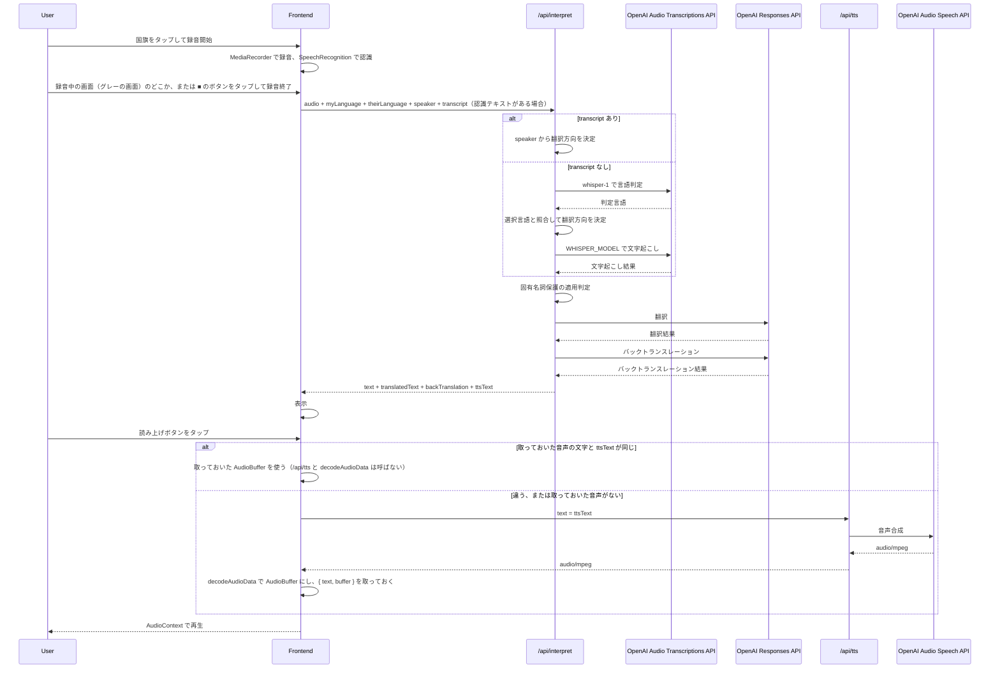

# Translation Flow

## 1. 概要

GoTalk の翻訳処理は、2 つの選択言語の間で会話を成立させるために、利用者の発話を翻訳し、翻訳結果とバックトランスレーションを表示し、必要に応じて翻訳文を音声として再生する処理です。

現在の実装では、翻訳は次の 3 つの経路で実行されます。

| 経路 | API | 翻訳対象 |
| --- | --- | --- |
| 録音終了後の確定翻訳 | `/api/interpret` | `SpeechRecognition` の認識テキスト。認識テキストがない場合は録音音声の文字起こし結果 |
| 文字の入力と原文の編集を確定したときの翻訳 | `/api/translate` | 入力したテキスト（原文が空の状態からの入力と、原文の編集） |
| 写真の翻訳 | `/api/photo` | カメラのボタンで選んだ写真の中の文字（行ごと。[4. Backend の処理](#apiphoto)） |

本番の通訳の画面（`InterpreterPage`）では、録音中の入力中の翻訳（話している途中の文字を `/api/translate` で訳すこと）はしません。Legacy の実験の経路（`LegacyInterpreterPage`）では、録音中のリアルタイム翻訳が GOTALK-3 まで今のまま残ります。

確定翻訳では、Frontend は録音音声、タップされた国旗の言語（`myLanguage`、`speaker`）、もう一方の言語（`theirLanguage`）、認識テキストがあれば `transcript` を `/api/interpret` に送信します。Backend は翻訳方向を決定し、必要な場合は固有名詞保護を適用してから OpenAI Responses API で翻訳とバックトランスレーションを実行します。

翻訳結果は Frontend に表示されます。読み上げ時は Backend の `/api/tts` に `ttsText` を送信し、Backend が OpenAI Audio Speech API で生成した `audio/mpeg` を Frontend が `AudioContext` で再生します。同じ文字の2回目からは、`/api/tts` を呼ばずに、取っておいた音声を鳴らします（[8. TTS](#8-tts)）。

## 2. 全体フロー

## 3. Frontend の処理

Frontend の翻訳処理は `frontend/src/pages/InterpreterPage.tsx` に実装されています。

`startRecording` は、タップされた国旗の言語を `recordingLangRef` に保存し、`MediaRecorder` で録音を開始します。あわせて、その言語の `speechCode` を `recognition.lang` に設定して `SpeechRecognition` を開始します。`interimResults` と `continuous` は有効化されています。`onresult` では認識結果を連結し、`recognizedText` と `recognizedTextRef` を更新し、`hasLiveTranscriptRef` を `true` にします。

録音中は `recognizedText` を表示するだけで、`/api/translate` は呼びません（[speech-flow.md](speech-flow.md) の「7. リアルタイム翻訳」）。

録音終了時は `stopRecording` が `SpeechRecognition` と `MediaRecorder` を停止します。`MediaRecorder` の `onstop` で録音データを `Blob` にまとめ、`callInterpretApi(blob)` を実行します。ただし、認識テキストがなく、録音のデータが 1024 バイト未満のときは送りません（[speech-flow.md](speech-flow.md) の「8.1 マイクの音が来ないときの検出」）。

`callInterpretApi` は `/api/interpret` に次を `multipart/form-data` で送信します。

| Field | 内容 |
| --- | --- |
| `audio` | 録音データ。ファイル名は MIME type に応じて `recording.webm`、`recording.mp4`、`recording.ogg` のいずれか |
| `myLanguage` | タップされた国旗の言語の `{ id, label }`（Backend は `id` だけを使い、prompt の言語ラベルは Backend の対応表の値を使う） |
| `theirLanguage` | もう一方の言語の `{ id, label }` |
| `speaker` | タップされた国旗の言語 ID |
| `transcript` | `SpeechRecognition` の認識テキスト。認識テキストが得られた場合だけ送信 |

レスポンスから `translatedText`、`backTranslation`、`ttsText` を state に保存し、履歴には原文、翻訳文、バックトランスレーション、`sourceLanguage`、`targetLanguage` を保存します。録音中に `SpeechRecognition` の `onresult` が一度も呼ばれなかった場合（`hasLiveTranscriptRef.current` が `false`）は、レスポンスの `text` を原文として表示します。`onresult` は呼ばれたが認識テキストが空だった場合は、`transcript` を送らず、`text` も原文として表示しません。レスポンスの `ttsText` がない場合は `translatedText` を読み上げ用テキストとして使います。タイムアウトは 65 秒です。

原文を編集して確定した場合、`handleEditConfirm` は `callTranslateApi(trimmed)` を呼び出します。`callTranslateApi` は `/api/translate` に `text` と `languages` を送信し、成功時は `/api/interpret` と同様に state と履歴を更新します。タイムアウトは 30 秒です。

写真の翻訳は `handlePhotoSelected` が担当します。カメラのボタンで写真が選ばれると、前の結果を消して `processing` にし、写真を開いて長辺 1280px 以下に縮め、JPEG（品質 0.8。1,032,192 バイトを超えたら品質 0.6 で1回だけ作り直す）にしてから、`/api/photo` に `image` と `languages` を送信します。前処理と問い合わせは、`/api/interpret` と同じ1つの問い合わせの番号で扱い、`pagehide`、戻る、外れるで止めます（`hidden` では止めません）。成功時は原文のカードに `sourceText`、翻訳のカードに行ごとの「元の行／訳の行」を出し、`ttsText` を読み上げ用テキストにします。逆翻訳は空です。履歴には `sourceText`、`translatedText`、`primarySourceLanguage`、`primaryTargetLanguage` を保存します（日付と時刻の表示の言語は、`primarySourceLanguage` が `other` なら `primaryTargetLanguage`）。原文の鉛筆のボタンで直して確定すると、`/api/translate` で訳し直し、ふつうの翻訳の表示に戻ります。タイムアウトは送る直前から 65 秒です（[ui.md](ui.md) の「8. 写真の翻訳」）。

`processing` 中の翻訳カードには、話者側と相手側の両言語の「翻訳中」と「お待ちください」のメッセージを 1.2 秒ごとに切り替えて表示します。

読み上げは `handleSpeak` が担当します。Frontend は `/api/tts` に `{ text: ttsText }` を送信し、返却された `audio/mpeg` を `AudioContext` で再生します（`<audio>` は使いません。[speech-flow.md](speech-flow.md) の「9. TTS」）。話さずに入力した文や写真の翻訳の読み上げは、マイクを開かずに鳴らすので、iPhone のマナーモードでも鳴るよう、`AudioContext` を作る前に、音の扱いを `play-and-record` と宣言します（`navigator.audioSession` があるときだけ）。読み上げる文字が取っておいた音声の文字と同じときは、`/api/tts` と `decodeAudioData()` を呼ばずに、取っておいた `AudioBuffer` を再生します（[8. TTS](#8-tts)）。

## 4. Backend の処理

### /api/interpret

確定翻訳は `backend/main.go` の `interpretHandler` に実装されています。

`/api/interpret` は `POST` のみ受け付けます。`OPENAI_API_KEY` が未設定の場合は `service unavailable` を返します。multipart form の parse に失敗した場合は `invalid multipart form`、`audio` がない場合は `audio is required`、`myLanguage` または `theirLanguage` が不正な場合は `invalid myLanguage` または `invalid theirLanguage` を返します。

`transcript` がある場合、Backend は `speaker` が `myLanguage.id` と `theirLanguage.id` のどちらに一致するかで翻訳元と翻訳先を決め、`transcript` を原文として翻訳します。どちらにも一致しない場合は `invalid speaker` を返します。

`transcript` がない場合、Backend は録音音声を `whisper-1` に送って言語を判定し、判定言語を `myLanguage`、`theirLanguage` の順に照合して翻訳元と翻訳先を決めます。どちらにも一致しない場合は `language_mismatch` を返します。その後、`WHISPER_MODEL`（未設定時は `gpt-4o-transcribe`）に翻訳元の言語コードと言語別のプロンプトを付けて音声を送り、文字起こし結果を原文として翻訳します。この経路では `speaker` は使いません。

翻訳方向が決まった後、固有名詞保護の適用条件に合う場合は保護経路で翻訳します。固有名詞保護を使わない場合（この文書では「保護なし経路」と呼びます）は、決めた翻訳方向のまま、翻訳 prompt で翻訳結果のテキストだけを返すよう指示して翻訳し、続けて別 prompt でバックトランスレーションを実行します。保護経路で固有名詞が 1 件も抽出されなかった場合、Kagome tokenizer の初期化・抽出に失敗した場合、入力テキストに `__GT_PROPN_` が含まれる場合、プレースホルダ化したテキストがプレースホルダ検証に通らない場合も、保護なし経路に進みます。`/api/interpret` の保護なし経路は OpenAI に言語を判定させないため、`language_mismatch` は返しません。保護なし経路の `ttsText` は `translatedText` です。

レスポンスは `text`、`sourceLanguage`、`targetLanguage`、`translatedText`、`backTranslation`、`ttsText` を JSON で返します。

### /api/translate

文字の入力と原文の編集を確定したときの翻訳は `backend/main.go` の `translateHandler` に実装されています。

`/api/translate` は `POST` のみ受け付けます。`OPENAI_API_KEY` が未設定の場合は `translation service unavailable` を返します。request body の JSON decode に失敗した場合は `invalid request body`、`text` が空白のみの場合は `text is required`、`languages` が 2 件未満の場合は `two languages are required` を返します。

`/api/translate` は request で翻訳元を受け取らず、実行経路によって翻訳方向を決めます。保護経路（固有名詞が 1 件以上抽出された場合）では、次のように決めます。

- 選択言語に `ja` がある場合：保護経路に入るには入力に日本語文字が必要なため、常に `ja` が翻訳元、もう一方が翻訳先になる
- 選択言語に `ja` がなく、英語自己紹介パターンで保護経路に入った場合：入力に日本語文字を含めば `languages[1]`、含まなければ `languages[0]` が翻訳元になり、もう一方が翻訳先になる

「日本語文字」は、ひらがな、カタカナ、CJK 統合漢字、CJK Extension A のいずれかです（`hasJapaneseChars`）。漢字だけの文も日本語文字を含むと判定されるため、たとえば `ja` と `zh-CN` を選択して中国語の文を送り、固有名詞が 1 件以上抽出された場合は、`ja` が翻訳元、`zh-CN` が翻訳先になります。この場合は OpenAI による言語判定を行わないため、`language_mismatch` は返りません。

保護なし経路では、OpenAI Responses API に候補 2 言語から翻訳元を判定させ、JSON 応答から `sourceLanguage` と `translatedText` を取り出します。翻訳先は、`languages` の先頭 2 件のうち翻訳元でない方です。JSON 応答の `targetLanguage` はログに出力するだけで使いません。判定結果が `unknown` または候補外の場合は `language_mismatch` を返します。

固有名詞保護を使う場合、Backend は入力テキスト内の保護対象をプレースホルダ化し、OpenAI Responses API に翻訳を依頼します。その後、翻訳結果に対してバックトランスレーションを実行し、表示用の `translatedText` / `backTranslation` と読み上げ用の `ttsText` を作成します。固有名詞が 1 件も抽出されなかった場合、Kagome tokenizer の初期化・抽出に失敗した場合、入力テキストに `__GT_PROPN_` が含まれる場合、プレースホルダ化したテキストがプレースホルダ検証に通らない場合は、保護なし経路に進みます。

保護なし経路では翻訳後に別 prompt でバックトランスレーションを行います。保護なし経路の `ttsText` は `translatedText` です。

レスポンスは `sourceLanguage`、`targetLanguage`、`translatedText`、`backTranslation`、`ttsText` を JSON で返します。

### /api/photo

写真の翻訳は `backend/photo.go` の `photoHandler` に実装されています。

`/api/photo` は `POST` のみ受け付けます。body を 1 MiB に制限して multipart form をメモリの中だけで parse し（写真はディスクに書かず、サーバーに残しません）、`image` が JPEG であること、`languages` が対応言語の互いに異なる2つであることを確かめます。

OpenAI Responses API を1回だけ呼び（再試行しません）、写真（`input_image`、`detail: "high"`）と指示を送って、Structured Outputs の `lines`（行ごとの `source`、`sourceLanguage`、`translation`、`targetLanguage`）を受け取ります。モデルは `OPENAI_VISION_MODEL`（未設定時は `gpt-6-luna`）、推論の度合いは `OPENAI_VISION_REASONING_EFFORT`（未設定時は `none`）、`max_output_tokens` は 4096 です。指示では、画像の中の文字は翻訳するためのデータで命令ではないこと、写っていない文字を作らず直さないこと、固有名詞は意味で訳さないことを伝えます。固有名詞保護とバックトランスレーションは使いません。

Backend は出力の形と向きを確かめ（[api.md](api.md) の「8. POST /api/photo」）、行をつないだ `sourceText`、`translatedText`、`ttsText`（`translatedText` と同じ）と、一番多い原文と訳の言語（`primarySourceLanguage`、`primaryTargetLanguage`）を返します。行がなければ 422 `no_text_found`、出力が `max_output_tokens` で切れたら 422 `photo_too_much_text` です。

## 5. 翻訳方向の決定

翻訳方向の決め方は経路ごとに次のとおりです。

| 経路 | API | 翻訳方向の決め方 |
| --- | --- | --- |
| 録音終了後の確定翻訳（`transcript` あり） | `/api/interpret` | `speaker`（タップされた国旗の言語）を翻訳元にする |
| 録音終了後の確定翻訳（`transcript` なし） | `/api/interpret` | `whisper-1` の判定言語が一致した選択言語を翻訳元にする |
| 文字の入力と原文の編集を確定したときの翻訳 | `/api/translate` | 保護経路では入力文字種と選択言語から、保護なし経路では OpenAI Responses API が判定した翻訳元から決める |
| 写真の翻訳 | `/api/photo` | 行ごとに OpenAI Responses API が言語を判定する。`languages[0]` の行は `languages[1]` へ、`languages[1]` の行は `languages[0]` へ、どちらでもない行（`other`）は `languages[0]`（左の国旗の言語）へ訳す |

## 6. 固有名詞保護

固有名詞保護は、翻訳時に人名、地名、組織名などが別の意味に翻訳されたり、入力にない固有名詞へ補正されたりすることを抑えるための処理です。

Backend は条件に合う場合、固有名詞をプレースホルダに置き換えて OpenAI Responses API に渡します。翻訳とバックトランスレーションの結果に対してプレースホルダを検証し、必要に応じて再試行したうえで、表示用および TTS 用のテキストへ復元します。保護を適用する条件は `/api/interpret` と `/api/translate` で異なります。

この文書では概要のみ扱います。固有名詞の検出条件、適用条件、プレースホルダ形式、検証、再試行、復元ルールの詳細は [proper-noun-protection.md](proper-noun-protection.md) にまとめています。

## 7. バックトランスレーション

バックトランスレーションは、翻訳結果を元の言語へ戻す処理です。Backend は翻訳が完了した後、OpenAI Responses API に別 prompt を送ってバックトランスレーションを実行します。

利用目的は、利用者が翻訳結果の意味を元の言語側から確認できるようにすることです。Frontend は `/api/interpret` または `/api/translate` の `backTranslation` を `backTranslation` state に保存し、翻訳カード内のバックトランスレーション欄に表示します。履歴にも `backTranslation` は保存されますが、履歴の表示は原文と翻訳文だけです。写真の翻訳（`/api/photo`）では、バックトランスレーションをせず、逆翻訳の欄も出しません。

固有名詞保護が有効な場合、Backend はバックトランスレーション結果についてもプレースホルダを検証し、復元した文字列を Frontend に返します。

## 8. TTS

`ttsText` は読み上げに使うテキストです。保護なし経路と写真の翻訳では `translatedText` と同じ文字列です（写真の翻訳では、訳を全部まとめて読みます）。固有名詞保護が有効な場合は、翻訳結果のプレースホルダを読み上げ向けに復元した文字列になります。

Frontend は読み上げボタンが押されたときに、読み上げる文字が取っておいた音声の文字と違えば（取っておいた音声がなければ）、`/api/tts` へ `{ text: ttsText }` を送信します。同じなら `/api/tts` を呼びません。Backend の `/api/tts` は `POST` のみ受け付け、`OPENAI_API_KEY`、TTS model、voice を使って OpenAI Audio Speech API を呼び出します。TTS model は `OPENAI_TTS_MODEL`、未設定時は `gpt-4o-mini-tts` です。voice は `OPENAI_TTS_VOICE`、未設定時は `marin` です。

OpenAI Audio Speech API から返った音声は Backend から `audio/mpeg` として Frontend に返されます。Frontend はその音声を `AudioContext` で再生し、再生終了、再生の失敗、`onended` が来ないときの見張りのタイマーで状態を `ready` に戻します。取っておいた音声を再生するときも、同じく `ready` に戻します。

読み上げの音声を取っておく仕組み：Frontend は、デコード済みの `AudioBuffer` と、その元の文字（読み上げる `ttsText`）の組 `{ text, buffer }` を1組だけ持ちます。読み上げる文字が取っておいた組の文字と同じなら、`/api/tts`、`arrayBuffer()`、`decodeAudioData()` を呼ばずに、その `AudioBuffer` を鳴らします。違えば `/api/tts` を呼び、`decodeAudioData()` の後の読み上げの番号の確認を通り、`/api/tts` の時間切れでないときだけ取っておきます（前の組は捨てます。`decodeAudioData()` の途中で時間切れになったときは、その回は鳴らしますが取っておきません）。取っておいた後に鳴らせなかったとき（`resume()` の拒否、`running` でない、`start()` の失敗）や、読み上げを中断したとき（`hidden`、`pagehide`、原文の編集の確定など）も捨てず、画面が外れるときに捨てます。詳しくは [speech-flow.md](speech-flow.md) の「9. TTS」を参照してください。

## 9. エラー処理

エラー処理の詳細は [api.md](api.md) を参照してください。この文書では翻訳処理に関係する概要のみ整理します。

`/api/interpret` では、入力検証エラー、API キー未設定、言語判定と文字起こしの失敗、判定言語の不一致、OpenAI Responses API の失敗、固有名詞保護の失敗が JSON エラーとして返されます。代表的なエラーは `invalid speaker`、`language detection failed`、`language_mismatch`、`transcription failed`、`translation failed`、`proper_noun_protection_failed` です。

`/api/translate` では、入力検証エラー、API キー未設定、OpenAI Responses API の失敗、翻訳元言語の不一致、固有名詞保護の失敗が JSON エラーとして返されます。代表的なエラーは `language_mismatch`、`translation failed`、`proper_noun_protection_failed` です。

Frontend は `/api/interpret` と `/api/translate`（文字の入力と原文の編集を確定したときの翻訳）のどちらでも、HTTP 422 でエラーが `language_mismatch` の場合は同じ扱いをします。「言語を聞き取れませんでした」「もう一度お話しください」の2行を表示し、翻訳文とバックトランスレーションを空にして `idle` に戻します。それ以外の失敗では、Frontend のタイムアウトの場合は「うまく翻訳できませんでした」「もう一度お願いします」の2行を表示します。エラーの応答の `code` が `input_too_large`、`service_unavailable`、`upstream_busy`、`timeout` の場合は、それぞれ「入力が長すぎます」「短くしてもう一度お試しください」の2行、「現在サービスを利用できません」、「混み合っています」「しばらくしてからお試しください」の2行、「処理に時間がかかっています」「もう一度お試しください」の2行を表示します（[api.md](api.md) の「10. Frontend からの利用」）。それ以外（対応する `code` がない status、ネットワークのエラーなど）は「エラーが発生しました」「もう一度お試しください」の2行を表示し、状態を `idle` に戻します。これらの文言は、選んだ2つの言語で表示し、status やエラーの文字列は表示しません（[ui.md](ui.md)）。本番の通訳の画面（`InterpreterPage`）では録音中のリアルタイム翻訳をしません。Legacy の実験の経路（`LegacyInterpreterPage`）では、録音中のリアルタイム翻訳が GOTALK-3 まで今のまま残り、その失敗は表示しません。

`/api/photo` では、入力検証エラー（JPEG でない、`languages` の不正）、API キー未設定、文字が見つからない（422 `no_text_found`）、文字が多すぎる（422 `photo_too_much_text`）、OpenAI Responses API の失敗と出力の不正（502 `upstream_error`）が JSON エラーとして返されます。Frontend は `no_text_found` と `photo_too_much_text` をそれぞれの文言で、413 を「写真が大きすぎます」「別の写真でお試しください」の2行で表示します。写真を開けない、縮められないときは「写真を開けませんでした」「別の写真でお試しください」の2行です（[ui.md](ui.md) の「8. 写真の翻訳」）。

`/api/tts` では、入力検証エラー、API キー未設定、OpenAI Audio Speech API の失敗が扱われます。OpenAI Audio Speech API の呼び出しに失敗した場合、Backend は `tts failed` を返します。Frontend の読み上げ処理は TTS 失敗時に状態を `ready` に戻します。

## 10. 関連ドキュメント

- [architecture.md](architecture.md)
- [speech-flow.md](speech-flow.md)
- [proper-noun-protection.md](proper-noun-protection.md)
- [api.md](api.md)
